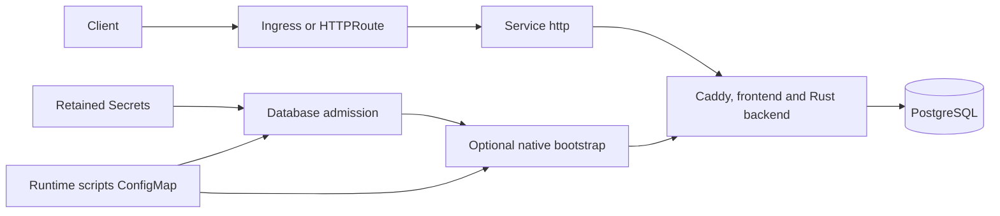

# Ryot design

## Scope

This chart deploys one production-oriented Ryot instance with the official image, a maintained HelmForge PostgreSQL
dependency or an external PostgreSQL database, local authentication, restricted Kubernetes privileges, and explicit
network boundaries. It owns the Kubernetes contracts required to start the native application safely: retained
authentication Secrets, database admission, first-user bootstrap, health probes, Service routing, optional Ingress and
Gateway API resources, External Secrets integration, and recovery evidence.

The supported application surface is intentionally narrower than every upstream feature. Ryot v10.5.0 is supported
with local password authentication and database-backed durable state. OIDC-linked accounts and native S3 storage are
rejected because the pinned upstream behavior does not satisfy the authorization boundary verified for this chart.

## Architecture

The official image combines a Rust backend, React Router frontend and Caddy under the upstream process supervisor. The
chart preserves that entrypoint; starting only the backend would remove the UI and proxy behavior. Caddy listens on the
configurable application port exposed by the named `http` container port. The Service and every default route resolve
to that named listener so `service.port` remains independent from the process port.

Before the public container starts, ordered init containers prepare the runtime. The first copies the identical Caddy
binary into an `emptyDir` without extended file capability metadata. The second writes the encoded database URL to a
mode-restricted memory volume. The third uses the official PostgreSQL client for read-only database admission. When
bootstrap is enabled, the fourth starts only the backend on loopback and calls the native registration and login APIs.

The release backend writes relative `tmp` data, unlike its debug build. Separate bounded volumes cover `/tmp`,
`/home/ryot/tmp`, the runtime home, generated database configuration and bootstrap state without hiding packaged
frontend assets. The root filesystem remains read-only and every container uses the same restricted security context.

## Design decisions

### Preserve the native process model

The chart keeps Caddy, frontend and backend under the upstream supervisor. A non-root init container copies Caddy to a
bounded runtime volume because its image file capabilities conflict with dropping all process capabilities. The binary
contents are unchanged, no privileged init work is introduced, and the mounted replacement is read-only.

### Admit the database before serving traffic

Database reachability alone is insufficient. The admission script authenticates, verifies the expected database state,
rejects OIDC-linked accounts and records whether first-user bootstrap is required. Native migrations therefore cannot
open a public listener before the chart's supported identity boundary has been checked.

### Bootstrap through native APIs

The administrator override closes the empty-token registration bypass while registration remains disabled. Bootstrap
uses native registration and login operations rather than writing password hashes or user rows. Interrupted bootstrap
may verify the same already-created account; it never resets an existing password or promotes an unrelated account.

### Treat PostgreSQL as the durability boundary

The HelmForge PostgreSQL dependency supplies its writable Service, Secret and password key through subchart helpers.
First-boot administrator scripts install `uuid-ossp` and `pg_trgm`; Ryot uses the separate application role. External
databases require the same extensions and privileges, Secret-backed credentials and verified TLS by default.

## Production boundary

One replica and Recreate updates are deliberate. The native scheduler and in-memory work are not proven safe under
horizontal concurrency, so this chart does not claim active-active availability or expose an HPA. Upgrades include an
application interruption. Platform operators must size resources for the combined frontend, backend and proxy and must
provide database availability appropriate to their own service objective.

PostgreSQL persists accounts, sessions and tracking data. Temporary imports, application logs and queued in-memory jobs
are ephemeral. Recovery uses native `pg_dump` and `pg_restore` into a separate empty database, then verifies retained
identity and private tracking content. That evidence proves logical recovery; it does not prove multi-node database
failover, backup retention, recovery-point objectives or reversal of application migrations.

Ingress, Gateway API, dual-stack Service settings, placement controls and External Secrets follow the repository's
common contracts. Operators own controller availability, certificates, public DNS, storage classes, external database
operations and backup storage.

## Security boundary

The workload runs as UID/GID 1001 with RuntimeDefault seccomp, a read-only root filesystem, no privilege escalation,
all Linux capabilities dropped and no service-account token. Writable paths are explicit bounded volumes. Credentials
come from retained Kubernetes Secrets or External Secrets targets; the rendered database URI is written only to a
memory-backed volume and is not passed as a process argument.

Default NetworkPolicy allows the application listener from same-namespace pods, DNS through selected cluster peers and
the bundled PostgreSQL destination. External databases, ingress controllers and provider APIs require explicit peers.
This isolation depends on a NetworkPolicy-capable CNI and selectors that match the target cluster.

OIDC and S3 are denied rather than merely undocumented. The pinned native OIDC flow accepts a stored subject without a
verified provider exchange, and the examined storage resolvers do not enforce the required user and object ownership
checks. Environment overrides cannot re-enable those paths. A Secret protects credentials at rest and in delivery; it
cannot repair missing application authorization.

## Observability boundary

Startup, readiness and liveness probes call the native proxy health path through the named application port. Operators
should monitor Deployment availability, probe failures, init-container exit states, Kubernetes events, resource
saturation, Caddy/backend logs and PostgreSQL health. The recovery scenario provides behavioral evidence for session and
private-collection durability.

Ryot v10.5.0 has no chart-verified Prometheus endpoint, so this chart does not fabricate a ServiceMonitor. PostgreSQL
monitoring remains the dependency's separate contract. SMTP delivery is also outside automated evidence because the
native test can report success after a transport failure; production alerting must verify receipt at the destination.

## Known gaps and limitations

- OIDC-linked databases are rejected until a corrected upstream release passes an authorization regression.
- Native S3 storage remains disabled until signing, read and deletion operations enforce user ownership.
- Only one application replica is supported; Recreate upgrades cause downtime.
- Temporary imports, logs and in-memory jobs are not included in database recovery.
- Required PostgreSQL extensions run only during first initialization of a new bundled data volume.
- External PostgreSQL extension setup, certificates, backups and availability remain operator responsibilities.
- SMTP delivery and provider-specific integrations require environment-specific end-to-end verification.
- Network isolation is ineffective without a compatible CNI and correct namespace and pod labels.

## Non-goals

The chart does not patch upstream Ryot source, replace its supervisor, implement an identity provider, emulate object
storage authorization, create a database failover system or promise zero-downtime upgrades. It does not store
production credentials in values, automatically reset an existing administrator, make Helm rollback reverse native
schema migrations, or infer safe egress destinations for arbitrary provider APIs.

The chart also avoids claiming telemetry that the pinned release does not expose. New application features enter the
supported contract only after their runtime behavior, authorization model, persistence boundary, documentation and
recovery implications are validated together.
