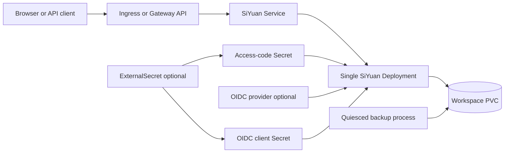

# SiYuan design

## Scope

This chart deploys the official SiYuan image as one private administrative
knowledge workspace. It owns the Kubernetes resources for retained native
authentication, optional OIDC admission, persistent workspace storage, HTTP
exposure, network isolation, scheduling, and behavioral health checks.

The image is used unchanged. The chart invokes the native kernel directly so it
can run as a restricted non-root process without the official entrypoint's root
account creation and recursive ownership changes.

## Architecture

SiYuan combines document files, configuration, history, assets, encryption
state, and embedded indexes in one workspace. Exactly one kernel may write that
workspace, regardless of PVC access mode. A Recreate Deployment prevents
rolling overlap and deliberately accepts upgrade downtime.

## Main Design Choices

- Pin the official multi-architecture image and do not rebuild or wrap it.
- Invoke `/opt/siyuan/kernel serve` directly with an explicit workspace and
  configurable native listener port.
- Enforce one replica, Recreate strategy, no HPA, and no PDB because SiYuan is a
  stateful singleton rather than a horizontally scalable service.
- Generate and retain a native access code in a Secret, with existing Secret and
  External Secrets alternatives for production credential ownership.
- Keep local access-code recovery available when OIDC is enabled.
- Require explicit OIDC claim admission unless the operator deliberately enables
  `allowAll`.
- Require native boot progress of 100 before startup and readiness succeed;
  liveness uses the local version endpoint without external dependencies.
- Persist the complete workspace and validate recovery from a quiesced archive
  into a fresh PVC instead of treating live index-file copies as backups.

## Production Boundary

Operators must provide a suitable StorageClass or existing PVC, protect access
and OIDC Secrets, terminate TLS at a WebSocket-capable edge, size resources for
indexing and plugins, and allow every external endpoint needed for identity,
sync, webhooks, or extension downloads. Never attach the workspace to another
running release, even on ReadWriteMany storage.

The chart retains generated PVCs on uninstall, but namespace deletion and
storage-provider lifecycle remain outside Helm. A production recovery plan must
quiesce the writer, archive the complete workspace, store encrypted off-cluster
copies, preserve encrypted-notebook recovery passwords separately, and exercise
restore into a new claim. Helm rollback does not reverse workspace migrations.

## Security Boundary

The main container runs as UID/GID 1000 with a read-only image filesystem,
dropped capabilities, RuntimeDefault seccomp, no privilege escalation, bounded
resources, and no Kubernetes API token. Writable workspace, home, and temporary
paths are explicit mounts. Native credentials are sourced from Secrets and are
not placed in command-line arguments or ConfigMaps.

The default NetworkPolicy permits same-namespace HTTP ingress and DNS egress;
explicit destinations are required for OIDC, synchronization, webhooks, and
extensions. OIDC client credentials and access codes remain separate. Every
admitted identity administers the same personal workspace, so identity-provider
assignment and exact claim rules are part of the security boundary.

Ingress annotations, HTTPRoute filters, extra environment variables, companion
containers, external Secrets, and additional egress rules are operator-controlled
trust extensions. The chart cannot make an untrusted extension or edge safe.

## Observability Boundary

Startup and readiness inspect native boot progress, while liveness verifies the
local kernel endpoint. Kubernetes Deployment, Pod, PVC, event, and log signals
cover workload health. Runtime validation exercises authenticated document
creation, anonymous rejection, Unicode export, persistence, retained credentials,
OIDC admission, upgrades, and fresh-PVC recovery.

The pinned release exposes no stable native Prometheus contract, so the chart
does not fabricate a ServiceMonitor or unrelated exporter. Metrics collection,
log retention, synthetic public checks, certificate monitoring, sync monitoring,
and backup-age alerts belong to the platform.

## Known Gaps and Improvement Candidates

- SiYuan has no supported multi-writer or external-database topology.
- Recreate upgrades include intentional downtime.
- The chart does not schedule backups because consistency requires coordinating a
  graceful writer shutdown with the operator's storage and retention platform.
- Native OIDC claim rules operate on top-level claims and `contains` is not an
  exact identity match.
- There is no application-native Prometheus endpoint in the pinned release.
- Encrypted notebooks still require separately protected recovery passwords and
  native encrypted backups.

## Explicit Non-Goals

- modifying or rebuilding the official SiYuan image
- multiple replicas or concurrent writers against one workspace
- external PostgreSQL, MySQL, or Redis backends unsupported by SiYuan
- installing an ingress controller, Gateway API CRDs, External Secrets Operator,
  certificate manager, identity provider, CNI, or monitoring stack
- providing a tenant-isolated collaboration service
- managing off-cluster backup transport, retention, or encryption keys
- converting Helm rollback into application-data rollback

## Validation Strategy

The mandatory chart gate renders every CI profile and validates schema, lint,
unit tests, real CRD schemas, Artifact Hub metadata, and sequential k3d runtime
behavior. Runtime tests cover native login, anonymous denial, notebook and
document lifecycle, Unicode export, pod replacement, retained access code,
normal Helm upgrades, optional OIDC discovery/JWKS/PKCE/nonce and claim denial,
dual-stack networking, External Secrets, Ingress, Gateway API, and quiesced
full-workspace restore into a fresh PVC.

<!-- @AI-METADATA
 type: guide
 title: SiYuan design
 description: Product-specific runtime and recovery design
 keywords: siyuan, design, oidc, storage
 purpose: Explain chart architecture and limits
 scope: chart
 path: charts/siyuan/DESIGN.md
 version: 1.1
 date: 2026-11-01
-->
