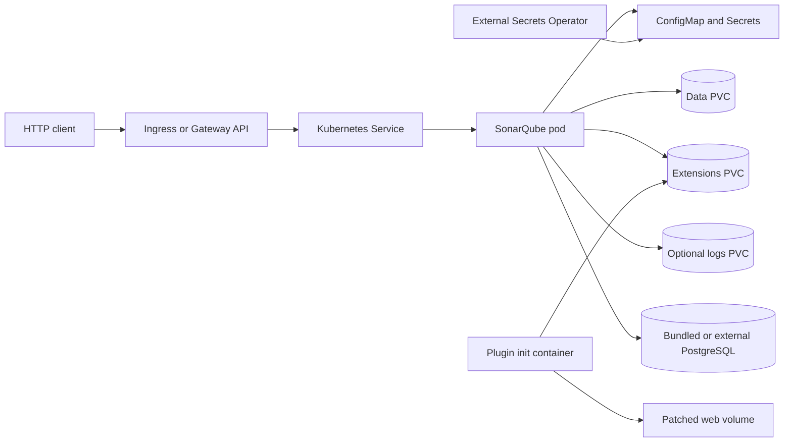

<!-- SPDX-License-Identifier: Apache-2.0 -->

# SonarQube Chart Design

## Scope

This chart operates one SonarQube Community Build application node. It supports
embedded evaluation, a bundled HelmForge PostgreSQL dependency, or an external
PostgreSQL service. It does not claim to provide SonarQube Data Center Edition
clustering.

## Architecture

The Service always targets the named `http` container port. Changing
`containerPorts.http` also changes `SONAR_WEB_PORT`, so the application listener,
probes, NetworkPolicy, and Service target remain aligned. `service.port` only
controls the client-facing Service port.

## Application and Database Decisions

The Deployment uses the `Recreate` strategy because a single Community Build
instance owns local search state and writable directories. The image is pinned to
`docker.io/library/sonarqube:26.8.0.126808-community`.

`sonarqube.databaseMode=auto` selects external settings first, then bundled
PostgreSQL when `postgresql.enabled=true`, and otherwise embedded evaluation.
Embedded mode is not a durable production database. Production releases should
use bundled or external PostgreSQL and persistent data and extensions volumes.

The bundled PostgreSQL integration includes a TCP readiness init container to
avoid a first-start connection race. Database credentials can come from generated
Secrets, existing Secrets, or External Secrets Operator resources.

## Plugin Design

Plugin installation runs in an init container while the application container
remains the official upstream image. Download URLs and optional SHA-256 checksums
are passed as environment variables, preventing shell interpretation of URL
characters. A configured checksum is verified before SonarQube starts.

The community branch plugin is pinned independently to `26.4.0`. Enabling it
downloads both the plugin JAR and patched web application, persists the JAR in the
extensions volume, and adds the required web and compute-engine Java agents. The
`ci/plugins.yaml` runtime scenario validates this enabled combination.

## Production Boundary

The chart owns Kubernetes resources and application wiring. Operators own:

- PostgreSQL capacity, availability, retention, and restore testing
- node kernel settings required by embedded Elasticsearch
- TLS termination, DNS, authentication policy, and ingress-controller lifecycle
- plugin compatibility decisions and internal artifact availability
- backup scheduling and recovery-point objectives

A recoverable backup includes PostgreSQL plus the data and extensions volumes.
The logs volume is optional and is not application state. Backups are not
automatically scheduled by this chart.

## Security Boundary

The pod defaults to UID/GID 1000, a read-only root filesystem, no privilege
escalation, dropped Linux capabilities, RuntimeDefault seccomp, and no service
account token. Writable SonarQube paths are explicit volumes.

NetworkPolicy is opt-in because CNI behavior and ingress identities vary by
cluster. When enabled, it can restrict ingress and DNS, HTTP, HTTPS, and PostgreSQL
egress. Plugin download destinations and checksums are operator-controlled; the
chart does not establish artifact trust when a checksum is omitted.

Secrets are referenced from Kubernetes Secret resources. Inline values are
supported for evaluation but should not be committed to source control.

## Observability Boundary

Startup and liveness probes call the system status endpoint. Readiness requires
the response to report `UP`. The Helm test and runtime smoke test verify the same
product-level API, including the pinned application version and configured
listener port.

The chart does not deploy a metrics collector, dashboard, log shipper, or alerting
rules. Platform operators own collection and alerting for SonarQube, PostgreSQL,
Kubernetes events, and persistent-volume capacity.

## Known Gaps

- Community Build is limited to one application node.
- The chart does not automate database or volume backups and restores.
- NetworkPolicy cannot express every external database or plugin mirror without
  operator-supplied rules.
- Plugin downloads require init-time network access unless artifacts are mirrored
  to an accessible internal endpoint.
- Host kernel requirements cannot be configured safely from a namespaced chart.

## Non-goals

- Operating multiple SonarQube application replicas or Data Center Edition
- Managing PostgreSQL outside the optional dependency lifecycle
- Configuring node kernel settings, ingress controllers, certificate issuers, or DNS
- Scheduling backups, restoring state, or choosing plugin compatibility on behalf
  of the operator

## Validation

Unit tests cover database modes, security settings, plugin checksum wiring,
exposure resources, persistence, Secrets, and custom ports. Runtime scenarios
exercise embedded, bundled, external-database, plugin, NetworkPolicy, context-path,
and non-default listener configurations. `scripts/runtime-smoke.mjs` verifies the
live `/api/system/status` contract rather than relying only on pod readiness.
