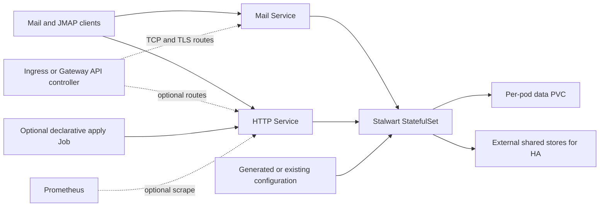

# Stalwart Chart Design

## Scope

The chart owns the Stalwart StatefulSet, Services and Kubernetes integration.
It does not own external stores, a Gateway controller, certificates, DNS,
webmail, or the database-backed Stalwart object model.

## Architecture

The single-replica default uses a stable StatefulSet identity and a local PVC.
HA moves durable application state to operator-managed shared stores while the
headless Service preserves pod discovery and node identities.

## Design Decisions

- A StatefulSet protects stable storage and peer identity across upgrades.
- Configuration has exactly one owner to avoid merging partially compatible
  generated and externally managed documents.
- Mail protocols and HTTP/JMAP use separate Services so operators can select
  distinct exposure policies.
- The chart exposes declarative administration as an opt-in Job rather than
  embedding credentials or mutable application objects in Helm state.

## Configuration Sources

Exactly one source supplies `/etc/stalwart/config.json`: a generated DataStore
object, an existing ConfigMap, or an existing Secret. Credentials are injected
through environment/file references and are never copied into a generated
Secret. A checksum covers generated config; external-source rotation remains
under the operator's rollout controller or `rolloutTrigger`.

## HA Invariants

StatefulSet identity provides stable hostnames and node leases. More than one
replica requires an external shared DataStore and disables the local data PVC.
Blob, search, in-memory, coordinator, and role objects live in the DataStore;
the production HA example installs them through the CLI apply Job. The chart
cannot prove an external service is itself highly available. An empty shared
database should be initialized by one replica before the release scales out.
This two-phase bootstrap keeps the StatefulSet's immutable pod management
policy stable across later upgrades.

## Exposure

The HTTP Service carries management/JMAP and metrics traffic. The mail Service
carries SMTP, submission, IMAP, POP3, and ManageSieve. STARTTLS listeners use
TCPRoute. Implicit TLS listeners may use TLSRoute passthrough. All routes are
disabled together with `gatewayAPI.enabled=false`.

## Security

The official image runs as UID/GID 2000. `NET_BIND_SERVICE` is the only added
capability because the image binary uses a file capability for privileged mail
ports. The root filesystem is read-only and service account token mounting is
disabled. No default password or chart-generated credential exists.

## Production Boundary

Operators own public DNS, trusted certificates, backup and restore procedures,
external store availability, capacity planning, and mail deliverability. A
multi-replica release is not safe until all Stalwart state categories use
shared stores as described in the HA example.

## Security Boundary

The chart supplies a hardened pod baseline and can restrict Kubernetes network
traffic. Operators own Stalwart authentication, administrator credentials,
TLS material, anti-abuse policy, trusted proxy configuration, and the security
of referenced Secrets and external stores.

## Observability Boundary

Health probes use the management listener. The chart can expose annotations or
a ServiceMonitor for Prometheus-compatible metrics; it does not install a
monitoring stack, define alert thresholds, or retain Stalwart logs.

## Known Gaps

- The chart cannot validate the availability or schema of external stores.
- Gateway API controllers differ in TCPRoute and TLSRoute support.
- Certificate issuance, mail reputation, queues, and backup recovery require
  environment-specific operational validation.

## Non-Goals

- Installing a webmail client, database, object store, or Gateway controller.
- Generating administrator passwords or copying external credentials.
- Managing DNS records, certificates, mail reputation, or Stalwart tenants.
