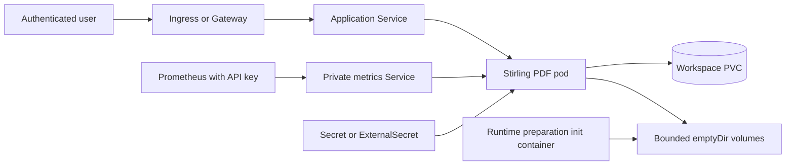

<!-- SPDX-License-Identifier: Apache-2.0 -->

# Stirling PDF design

## Scope

This chart runs the official full Stirling PDF image as an authenticated, single-writer Community deployment. It
supports the embedded H2 database, durable application configuration, custom files and pipelines, the bundled OCR and
office tools, Kubernetes Ingress and Gateway API entry points, External Secrets Operator credentials, and the native
authenticated Prometheus endpoint. The chart owns the workload and its immediate Kubernetes resources; cluster-wide
edge, storage, backup, monitoring and secret-management controllers remain operator responsibilities.

The contract is deliberately conservative. One pod and one workspace claim form one application instance. The chart
does not reinterpret a shared filesystem as a database cluster, replace the upstream entrypoint, or weaken native
authentication to simplify health checks or monitoring.

## Architecture

The application Service exposes the configurable listener through a named `http` target port. Ingresses and generated
HTTPRoutes select that Service, never the management endpoint. When metrics are enabled, a second ClusterIP Service
targets the distinct management port. NetworkPolicy rules separate application ingress, management ingress, DNS and
explicit outbound web access.

The retained workspace claim is mounted at the upstream `configs`, `customFiles` and `pipeline` paths through
subdirectories. Temporary documents, the application home, logs, runtime tools and experimental storage use bounded
`emptyDir` volumes. An init container copies `/usr/local/bin` before the main container starts, because mounting an empty
directory directly there would hide Ghostscript, OCR and UNO executables expected by the official image.

## Design decisions

Native authentication is always enabled. A generated password is retained with Helm `lookup`, while
`auth.existingSecret` and ESO provide GitOps-friendly ownership. Initial credentials bootstrap a new H2 database; they
are not a password-reset mechanism for an existing database. The chart rejects mixed credential sources and attempts
to override security-critical environment variables.

The Deployment uses `Recreate` and the schema limits `replicaCount` to one. H2 and the workspace are a single-writer
unit, so rolling replacement or multiple replicas would create concurrent writers even when the storage class offers
ReadWriteMany. This trades uninterrupted rollout for data integrity. Operators should drain conversions before an
upgrade and schedule a maintenance window.

The official image and entrypoint remain intact. Writable mounts are narrowly scoped instead of making the root
filesystem writable. The application runs as UID and GID 1000, drops every capability, disables privilege escalation,
uses RuntimeDefault seccomp and receives no service-account token. Resource requests and limits include room for Java
plus native conversion processes; `JAVA_CUSTOM_OPTS` limits the heap without pretending that Java is the only memory
consumer.

## Production boundary

The chart provides safe Kubernetes defaults, but production readiness depends on the surrounding platform. Operators
must supply a TLS-terminating edge, an appropriate StorageClass, independent backups, monitored capacity, restricted
Secrets and a CNI that enforces NetworkPolicy. Proxy upload limits and timeouts must be aligned with
`server.maxUploadSize`, `server.maxRequestSize` and `server.connectionTimeoutMilliseconds`; application values cannot
configure an external ingress controller.

Upgrades preserve resource names, credential references and the workspace claim. New values are additive and defaults
remain compatible with releases installed from chart 1.0.1. A normal upgrade and an upgrade using `--reuse-values` are
both release gates. Nevertheless, a Helm rollback changes manifests only and cannot reverse an upstream H2 migration.
Back up and test restoration before changing application versions.

## Security boundary

Stirling PDF processes untrusted document formats with native binaries. Authentication, restricted pod security and
network isolation reduce exposure but do not make document conversion risk-free. Restrict access to trusted users,
patch promptly, inspect image vulnerability reports independently, and avoid mounting unrelated Secrets or host paths.
Document contents, passwords and API keys must not be placed in values files, ConfigMaps, logs or scrape configuration.

Default NetworkPolicy permits application traffic from the namespace and DNS egress. Remote URL conversion requires
explicit `networkPolicy.webEgress` peers and ports. Cross-namespace ingress and monitoring also require intentional peer
selectors. These controls depend on a policy-capable CNI and do not replace Stirling PDF's SSRF defenses.

## Observability boundary

Readiness, liveness and startup probes use the native status endpoint on the application listener. Metrics use a
separate management listener and require a native `X-API-KEY`. Because the supported ServiceMonitor contract cannot
represent that header safely, the chart can generate an `additionalScrapeConfigs` Secret referencing a mounted API-key
file. It never embeds the credential in a ConfigMap or treats it as a Bearer token.

The native meter filter currently exposes HTTP request counters rather than a complete JVM, conversion-latency or
storage-capacity view. Kubernetes metrics must cover memory, restart count, PVC use and pod availability. Session labels
can increase cardinality; operators should enforce sample limits and retention and validate the final Prometheus
configuration with their deployed version.

## Known gaps and limitations

- Community H2 has no supported active-active mode and every restart or upgrade causes downtime.
- Temporary conversion files disappear with the pod and are not a durable document library.
- Online-consistent H2 backup is not automated; snapshots require application quiescing and restore testing.
- Additional OCR languages are not downloaded automatically and must come from trusted compatible sources.
- Native OAuth SSO, external SQL and clustering may require upstream licensing and are not validated by this chart.
- The chart cannot guarantee ingress-controller limits, CNI policy enforcement, storage durability or external backup
  retention.

## Non-goals

This chart does not provide paid entitlements, bypass license checks, operate an external database, create a distributed
H2 cluster, install a Gateway or ingress controller, deploy Prometheus, or manage volume-snapshot infrastructure. It
does not retain processed documents as a content-management system, automatically fetch OCR assets, or promise that a
Helm rollback reverses application data changes. Those boundaries keep the supported contract small enough to validate
with real authentication, conversion, OCR, office, recovery and monitoring scenarios on k3d.
