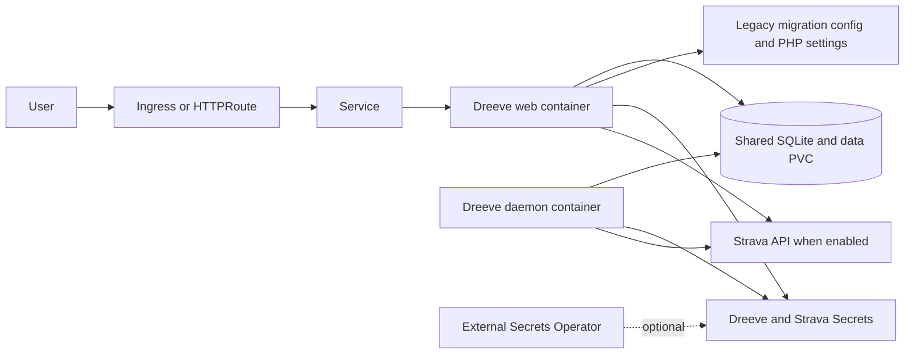

<!-- SPDX-License-Identifier: Apache-2.0 -->

# Dreeve Chart Design

## Scope

This chart deploys Dreeve, formerly Statistics for Strava, as a self-hosted dashboard for importing and visualizing
fitness activities.

Supported use cases:

- personal fitness dashboards
- single-user or household activity analytics
- SQLite-backed self-hosted deployments
- file imports or Strava API imports
- runtime credential management through chart values, existing Secrets, or External Secrets Operator

## Architecture

## Design Choices

- Use the official, version-pinned `robiningelbrecht/dreeve` image.
- Co-locate the mandatory web and daemon containers. They share SQLite and RWO storage without cross-node locking.
- Keep the deployment single-replica because SQLite is single-writer and the upstream app is not designed for horizontal scaling with shared writes.
- Keep persistence enabled by default because imports, generated assets, and SQLite data are stateful.
- Bootstrap `build`, `database`, `files`, `gear-maintenance`, and `watch` before either application container starts.
- Preserve legacy root-level `strava.db` and `dreeve.db` files through compatibility links during v4 migrations.
- Keep the v4 YAML ConfigMap mounted for the one-time v5 migration; new settings live in SQLite and the admin panel.
- Use the upstream Caddy metrics endpoint for web probes and the migrated database file for daemon probes.
- Run both application containers as UID/GID 82 with read-only root filesystems and bounded writable mounts.
- Add only `NET_BIND_SERVICE` to the web container because the upstream FrankenPHP binary carries that file capability.
- Render Gateway API HTTPRoutes as an opt-in HTTP exposure path alongside Ingress.
- Keep the deprecated `gatewayApi` alias only for compatibility; new values should use `gatewayAPI`.
- Render ExternalSecret resources only when requested. The chart does not install External Secrets Operator or provider-side SecretStores.
- Keep Service dual-stack fields opt-in so clusters without dual-stack support keep default behavior.

## Production Boundary

Recommended production controls:

- provide Strava credentials through `strava.existingSecret` or External Secrets Operator
- configure a public `strava.config.general.appUrl` that matches the OAuth callback URL
- keep persistence enabled with a durable storage class
- back up the PVC before upgrades
- expose the UI only through an authenticated ingress/Gateway policy or trusted network
- set explicit resources for shared clusters

## Security Boundary

- Dreeve session secrets, bcrypt hashes, API keys, and Strava OAuth credentials are Secret-backed.
- The chart-managed mock credentials are validation fixtures, not production credentials.
- Service account token automounting is disabled for both the pod and generated ServiceAccount.
- The pod uses non-root execution, RuntimeDefault seccomp, disabled privilege escalation, and read-only root filesystems.
- Writable state is limited to the shared PVC and size-bounded `emptyDir` volumes for PHP, Caddy, cache, and temporary data.
- NetworkPolicy is opt-in because Strava, map tiles, notifications, AI providers, and DNS create deployment-specific egress needs.
- TLS termination, external authentication, SecretStore policy, and storage encryption remain platform responsibilities.

## Observability Boundary

- Startup, readiness, and liveness probes validate the local FrankenPHP metrics endpoint.
- Daemon probes confirm that the migrated SQLite database exists; container termination still detects daemon process failure.
- Operators use application logs, pod restart counts, events, and PVC capacity for routine diagnosis.
- The chart does not create a ServiceMonitor because the upstream Caddy metrics endpoint is localhost-only and is not an application SLI contract.
- Alerting, log aggregation, storage monitoring, and synthetic user checks remain platform responsibilities.

## Known Gaps

- SQLite prevents horizontal scaling and zero-downtime rolling updates.
- Dreeve does not expose a stable Prometheus application metrics contract.
- NetworkPolicy egress cannot be safely precomputed for every optional integration.
- Existing PVCs must support the configured UID/GID and `fsGroup`; some NFS implementations require manual ownership repair.
- The chart preserves legacy YAML only for migration; v5 configuration changes must be made in the admin panel.

## Non-Goals

- multi-replica SQLite coordination
- external database support
- Strava OAuth app creation
- installing Gateway API CRDs or controllers
- installing External Secrets Operator
- managing Strava API applications or generating admin password hashes
- backing up or restoring the PVC automatically

## Validation

The chart is expected to pass:

- Helm lint and strict lint
- Helm template rendering for default and CI values
- helm-unittest coverage for config, secrets, service, ingress, Gateway API, ExternalSecret, PVC, and deployment
- kubeconform validation for Kubernetes-native default manifests
- local k3d deployment smoke tests with pod logs and namespace events checked

<!-- @AI-METADATA
type: design
title: Statistics for Strava Chart Design
description: Design document for the Dreeve Helm chart covering its sidecar daemon, SQLite, persistence, security, and operational boundaries.
keywords: dreeve, strava, statistics, helm, sqlite, gateway-api, external-secrets
purpose: Document chart architecture, boundaries, and operational decisions.
scope: Chart Design
relations:
  - charts/strava-statistics/README.md
  - charts/strava-statistics/docs/configuration.md
  - charts/strava-statistics/docs/operations.md
path: charts/strava-statistics/DESIGN.md
version: 1.1
date: 2026-10-25
-->
