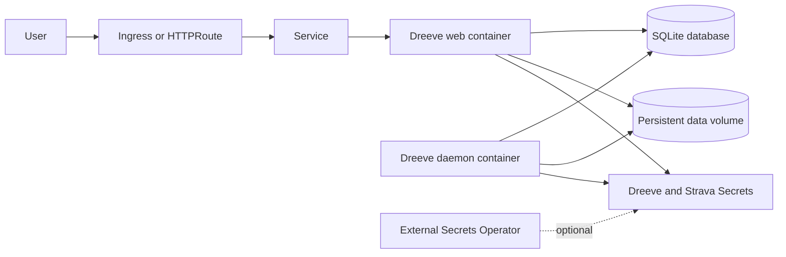

<!-- SPDX-License-Identifier: Apache-2.0 -->

# Dreeve Helm Chart

Deploy [Dreeve](https://github.com/dreeveapp/dreeve), formerly Statistics for Strava, on Kubernetes with the official
`robiningelbrecht/dreeve` image. Dreeve is a self-hosted fitness dashboard backed by SQLite and supports activity-file
imports or the Strava API.

## Features

- Official Dreeve image pinned to a released version
- Web application and mandatory daemon in one pod, sharing the SQLite database
- Persistent database, build cache, uploaded files, gear assets, and watch directory
- File-import and Strava API modes
- Admin credentials and runtime secrets from chart-managed or existing Secrets
- Optional External Secrets, Ingress, Gateway API, NetworkPolicy, and PodDisruptionBudget resources
- Non-root execution, read-only root filesystems, RuntimeDefault seccomp, and disabled service account token mounting
- Startup, readiness, and liveness probes based on the upstream runtime contracts

## Architecture



The Deployment uses `Recreate` and one replica. The web and daemon containers remain in the same pod so an RWO volume
can safely back SQLite without concurrent replicas.

## Installation

### HTTPS Repository

```bash
helm repo add helmforge https://repo.helmforge.dev
helm repo update
helm install dreeve helmforge/strava-statistics -f values.yaml
```

### OCI Registry

```bash
helm install dreeve oci://ghcr.io/helmforgedev/helm/strava-statistics -f values.yaml
```

## Configuration Examples

Create an admin password hash with the same image version before production installation:

```bash
docker run --rm -it --entrypoint bin/console robiningelbrecht/dreeve:v5.6.2 security:hash-password
```

Then provide unique application secrets and, when using `stravaApi`, Strava credentials:

```yaml
dreeve:
  appUrl: https://dreeve.example.com
  appSecret: replace-with-a-long-random-value
  adminUsername: admin
  adminPasswordHash: '$2y$13$replace-with-the-generated-bcrypt-hash'
  importMode: stravaApi

strava:
  clientId: "12345"
  clientSecret: replace-me
  refreshToken: replace-me
```

The `mock-*` defaults exist only so the chart can be rendered and tested. Never use them in a production installation.

## Existing Secrets

Keep Dreeve and Strava credentials in separate existing Secrets:

```yaml
dreeve:
  existingSecret: dreeve-runtime
  existingSecretAppSecretKey: app-secret
  existingSecretAdminPasswordHashKey: admin-password-hash
  existingSecretApiKeyKey: api-key

strava:
  existingSecret: strava-credentials
  existingSecretClientIdKey: client-id
  existingSecretClientSecretKey: client-secret
  existingSecretRefreshTokenKey: refresh-token
```

The API key is optional. If its key is absent, Dreeve keeps the activity-upload API closed.

## File Import Mode

File mode does not require Strava credentials:

```yaml
dreeve:
  importMode: files
  appUrl: https://dreeve.example.com
  appSecret: replace-with-a-long-random-value
  adminPasswordHash: '$2y$13$replace-with-the-generated-bcrypt-hash'

strava:
  clientId: ""
  clientSecret: ""
  refreshToken: ""
```

Both containers mount the shared watch directory at `/var/www/watch`.

## External Secrets

`externalSecrets.items` can create either or both existing Secrets. See
[`examples/external-secrets.yaml`](examples/external-secrets.yaml) for a reusable mapping.

## Gateway API

```yaml
gatewayAPI:
  enabled: true
  httpRoutes:
    - name: web
      parentRefs:
        - name: public
          namespace: gateway-system
      hostnames:
        - dreeve.example.com
```

## Security

The default pod runs as numeric UID/GID `82`, uses `RuntimeDefault` seccomp, and mounts writable paths through bounded
PVC or `emptyDir` volumes. Both application containers use read-only root filesystems and disable privilege escalation.
The web container adds only `NET_BIND_SERVICE`, which is required by the upstream FrankenPHP binary capability and is
the sole capability permitted by the Kubernetes Restricted Pod Security Standard.

For production:

- replace all mock secrets or use existing Secrets/External Secrets;
- set `dreeve.appUrl` to the public root URL and terminate TLS at Ingress or Gateway;
- restrict the admin route with `dreeve.adminAllowedIps` or an edge access policy;
- enable and configure `networkPolicy` only after declaring required ingress, DNS, Strava, map, and integration egress;
- snapshot the PVC before upgrades and test recovery;
- keep the single-replica `Recreate` strategy because SQLite is single-writer.

## Key Values

| Key | Default | Description |
| --- | --- | --- |
| `image.repository` | `docker.io/robiningelbrecht/dreeve` | Official Dreeve image |
| `image.tag` | `v5.6.2` | Pinned Dreeve release |
| `dreeve.appUrl` | `http://localhost:8080` | Public root URL |
| `dreeve.importMode` | `stravaApi` | `stravaApi` or `files` |
| `dreeve.appSecret` | `mock-app-secret` | Admin-session signing secret; replace in production |
| `dreeve.adminPasswordHash` | `""` | Bcrypt admin password hash |
| `dreeve.existingSecret` | `""` | Existing Secret for Dreeve runtime secrets |
| `strava.clientId` | `mock-client-id` | Validation-only Strava client ID default |
| `strava.clientSecret` | `mock-client-secret` | Validation-only Strava client secret default |
| `strava.refreshToken` | `mock-refresh-token` | Validation-only Strava refresh token default |
| `persistence.enabled` | `true` | Persist SQLite and shared runtime data |
| `persistence.size` | `2Gi` | Shared PVC request |
| `daemon.enabled` | `true` | Run the mandatory Dreeve daemon sidecar |
| `resources.limits.cpu` | `2` | Web CPU limit |
| `daemon.resources.limits.cpu` | `2` | Daemon CPU limit |
| `service.port` | `80` | Kubernetes Service port |
| `networkPolicy.enabled` | `false` | Render an explicit NetworkPolicy |
| `podDisruptionBudget.enabled` | `false` | Protect the single pod from voluntary disruption |

The complete value contract and migration guidance are in
[`docs/configuration.md`](docs/configuration.md).

## Upgrade Notes

`v5.6.2` includes the upstream fix for the October 2026 critical PHP remote-code-execution vulnerability. Earlier
Dreeve releases must be upgraded. The former `robiningelbrecht/strava-statistics:v5.0.0` tag now serves only an upstream
rename notice, so this chart uses the current official `robiningelbrecht/dreeve` repository.

When migrating from a v4 chart release, keep `strava.config` mounted for the first successful v5 startup so Dreeve can
copy supported YAML settings into SQLite. Verify the settings in the admin panel, then remove obsolete YAML customizations.
Back up the PVC before the upgrade. See the
[official v4-to-v5 migration guide](https://docs.dreeve.app/getting-started/migrating-from-v4/) and
[v5.6.2 release notes](https://github.com/dreeveapp/dreeve/releases/tag/v5.6.2).

## Troubleshooting

### Pod waits for the database schema

The daemon waits until the web container finishes migrations. Inspect both containers:

```bash
kubectl logs deploy/<release>-strava-statistics -c strava-statistics
kubectl logs deploy/<release>-strava-statistics -c daemon
```

### Admin login fails

Confirm `ADMIN_PASSWORD_HASH` contains the bcrypt hash exactly as generated. Helm values do not require Docker Compose's
double-dollar escaping. Also verify that `dreeve.appUrl` matches the browser URL.

### Imports are killed

Dreeve imports can be memory intensive. Increase both the web/daemon memory limit and the PHP `memory_limit` contract
if the container reports `OOMKilled`; the chart defaults the PHP limit to `4G` and container limits to `5Gi`.

### PVC permission errors

The bootstrap init container creates the shared storage layout with the pod's filesystem group. Confirm the storage
class honors `fsGroup` and that an existing claim is writable by UID/GID `82`.

## Limitations

- SQLite requires one pod and `Recreate`; horizontal scaling is unsupported.
- The daemon is mandatory for v5 background processing.
- The chart does not install Ingress, Gateway API, or External Secrets controllers.
- NetworkPolicy egress destinations depend on enabled integrations and must be supplied by the operator.

## More Information

- [Dreeve documentation](https://docs.dreeve.app)
- [Dreeve source](https://github.com/dreeveapp/dreeve)
- [Chart design](DESIGN.md)
- [Operations runbook](docs/operations.md)
- [HelmForge chart source](https://github.com/helmforgedev/charts/tree/main/charts/strava-statistics)

### Security Scan: `strava-statistics`

| Framework | Score |
| --- | --- |
| MITRE + NSA + SOC2 | **72.72727%** |

> Security posture acceptable.

<!-- @AI-METADATA
type: chart-readme
title: Dreeve Helm Chart
description: README for the Dreeve fitness dashboard Helm chart
keywords: dreeve, strava, fitness, statistics, dashboard, sqlite
purpose: Chart installation, configuration, security, upgrade, and troubleshooting guidance
scope: Chart
relations:
  - charts/strava-statistics/values.yaml
  - charts/strava-statistics/DESIGN.md
  - charts/strava-statistics/docs/configuration.md
path: charts/strava-statistics/README.md
version: 1.2
date: 2026-10-25
-->
