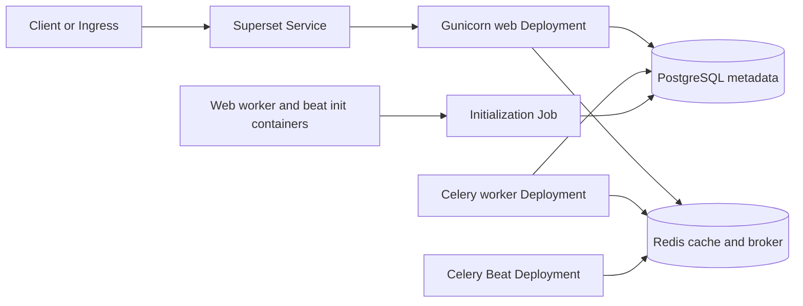

<!-- SPDX-License-Identifier: Apache-2.0 -->
# Apache Superset chart design

## Scope

This chart runs Apache Superset as separate web, Celery worker, and Celery Beat
workloads. It owns application configuration, initial database migration,
initial administrator creation, the Service, optional Ingress, namespaced wait
RBAC, NetworkPolicy, and an optional PostgreSQL backup CronJob. PostgreSQL and
Redis may come from HelmForge subcharts or operator-managed services.

Superset dashboards, users, connections, and security metadata belong in
PostgreSQL. Redis is a cache, Celery broker, and result backend. Application
pods are replaceable and do not own durable state.

## Architecture

The web process runs the production Gunicorn WSGI server and binds to
`web.containerPort`. The Service targets the named `http` port, so
`service.port` remains an independent cluster-facing port. The official
`/health` endpoint backs startup, liveness, and readiness probes.

The managed initialization Job performs `superset db upgrade`, creates the
configured administrator, runs `superset init`, and optionally loads examples.
Application pods wait for that specific release-revision Job through a
namespaced, read-only Role. This ordering prevents multiple processes from
concurrently initializing Flask-AppBuilder metadata.

## Decisions

### Managed initialization instead of a Helm hook

A pre-install hook cannot reach bundled PostgreSQL or Redis because Helm runs
hooks before ordinary dependency resources. A post-install hook runs too late
when `--wait` is used because application pods are already expected to become
Ready. The chart therefore creates an ordinary revisioned Job and makes the
long-running workloads wait for it.

### URLs are assembled inside Python

Database and Redis passwords remain Secret-backed environment variables.
`superset_config.py` URL-encodes credentials before building connection URLs,
so characters such as `@`, `/`, `#`, and `:` cannot corrupt a URI. The rendered
ConfigMap never contains credential values.

### Runtime packages are a compatibility path

The Superset 6.1.0 release image is a lean image. The default path installs the
PostgreSQL and Redis clients into an ephemeral `/tmp` target in every Superset
process so the official image works without a derived image. Operators may add
shell-safe, pinned package specifications through
`superset.extraPythonPackages`.

Production platforms should build an immutable derived image containing every
required database driver, select that image with an immutable tag, and set
`superset.installPythonPackages=false`. This removes package-index access and
startup variability.

### Explicit datastore modes

Exactly one PostgreSQL mode and one Redis mode must be selected. The chart
rejects a disabled subchart in `subchart` mode and an enabled subchart in
`external` mode. External modes require a host and either an inline password or
an existing Secret. Replication mode connects only to the writable primary
Service.

## Production boundary

The chart provides safe Kubernetes wiring, but production availability depends
on decisions outside the chart:

- Use managed or replicated PostgreSQL and Redis where the recovery objective
  requires them.
- Back up the PostgreSQL metadata database and regularly test restores.
- Build a derived Superset image with required data-warehouse drivers and, for
  alerts or reports, the supported browser dependencies.
- Supply realistic resources, topology constraints, and disruption policy for
  the cluster size.
- Keep Celery Beat at one replica to avoid duplicate scheduled work.
- Treat major Superset upgrades as database migrations with a rollback plan.

The bundled datastores are convenient, persistent standalone instances. They
are not an automatic high-availability design.

## Security boundary

The chart preserves generated application secrets across upgrades and supports
operator-owned Secrets. The Superset `SECRET_KEY` encrypts sensitive metadata
and signs sessions; losing or changing it invalidates sessions and can make
stored secrets unreadable. Production installations should create it outside
the release and keep it in a recoverable secret-management system.

Superset containers run as UID/GID 1000 with `RuntimeDefault` seccomp, no
privilege escalation, all Linux capabilities dropped, and a read-only root
filesystem. EmptyDir volumes provide only the writable home and `/tmp` paths.
The wait container receives the namespaced API token only while managed
initialization is enabled; the initialization and backup Jobs explicitly do not
mount API tokens.

NetworkPolicy permits the configured web listener and allows egress by default.
Restrict `networkPolicy.ingressFrom` and `networkPolicy.egress` to the ingress
controller, DNS, datastores, package index, and data sources used in each
environment. Treat `superset.extraConfig` as trusted Python code.

## Observability boundary

Kubernetes probes report web-process health through `/health`. They do not prove
that a dashboard query, Celery task, alert, report, PostgreSQL backup, or
external data source is healthy. Operators should collect web and Celery logs,
Job status, PostgreSQL and Redis metrics, request latency, task queue depth,
worker failures, and backup completion alerts.

The chart exposes standard labels for log and metrics selection. A
ServiceMonitor is not created because Superset metrics exporters and monitoring
stacks vary; add one through `extraManifests` when the chosen Superset metrics
integration is configured.

## Known gaps

- The default official image installs Python dependencies at startup.
- The chart does not provision a headless browser for alerts and reports.
- The NetworkPolicy cannot infer external data-source destinations.
- There is no built-in restore Job; restore is an operator-controlled procedure.
- Worker and Beat process health requires operational monitoring beyond the web
  `/health` endpoint.

## Non-goals

- Provisioning data sources, dashboards, charts, roles, or OAuth clients.
- Managing PostgreSQL or Redis outside their selected subcharts.
- Building a custom Superset image or choosing warehouse-specific drivers.
- Configuring an ingress controller, certificate issuer, object store, or
  observability stack.
- Automatically rotating `SECRET_KEY`; rotation requires the upstream
  `PREVIOUS_SECRET_KEY` and `superset re-encrypt-secrets` workflow.

## References

- [Superset configuration](https://superset.apache.org/docs/6.0.0/configuration/configuring-superset/)
- [Superset installation methods](https://superset.apache.org/docs/6.0.0/installation/installation-methods/)
- [Superset source](https://github.com/apache/superset)
- [Chart configuration](docs/configuration.md)
- [Operations guide](docs/operations.md)
- [Security guide](docs/security.md)
