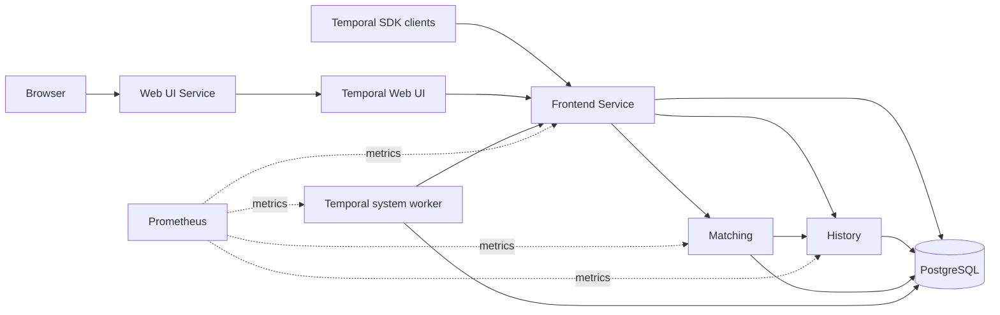

# Temporal Chart Design

## Scope

The chart deploys one Temporal cluster with independent frontend, history,
matching, and worker services, an optional Web UI, optional admin tools,
Temporal schema automation, and either bundled or external PostgreSQL. It does
not deploy application Workers, Elasticsearch, cross-cluster replication, or a
Gateway controller.

## Architecture

Frontend is the only SDK-facing server role. History owns mutable workflow
state and timers, matching owns task queues, and worker runs Temporal system
workflows. History is an ordered StatefulSet to serialize cluster metadata
bootstrap; the other roles are Deployments. Each role receives the shared
configuration with its own `SERVICES` value and exposes membership plus
metrics through a headless Service.

The Web UI has a separate Deployment and Service. `containerPorts.web` sets the
real UI process through `TEMPORAL_UI_PORT`; `webService.port` remains the
independent Kubernetes Service port. `containerPorts.metrics` configures the
Temporal Server Prometheus listener, while `monitoring.servicePort` controls
the headless Service port that targets the named metrics container port.

## Design Decisions and Trade-offs

- Server roles are separate workloads so scaling, failure domains, and resource
  profiles can be managed independently.
- The bundled PostgreSQL dependency optimizes evaluation and small deployments;
  an externally operated database is preferred when independent HA, backup,
  and lifecycle controls are required.
- Schema setup uses the official Temporal tooling and gates server startup on
  the exact expected schema versions. This favors safe upgrades over fast pod
  startup.
- HTTPRoute and GRPCRoute use separate contracts and default backends so a Web
  UI route cannot accidentally expose the SDK endpoint.
- Listener ports and Service ports are independent. This preserves normal
  Kubernetes port translation and ensures an override changes the real process.
- NetworkPolicy and ServiceMonitor resources are opt-in because controllers,
  DNS labels, monitoring namespaces, and database topology are cluster-specific.

## Persistence Lifecycle

Bundled mode installs the HelmForge PostgreSQL subchart and creates the
`temporal` and `temporal_visibility` databases. A revision-scoped schema Job
runs `temporal-sql-tool`. Server init containers proceed only after both schema
versions are readable. External mode disables the dependency; the operator
must create both databases, provide connectivity, and supply the credential
Secret. Helm hooks are supported only for an already reachable external
database.

## Production Boundary

The chart owns Temporal workloads, configuration, schema jobs, Services,
optional routes, and optional policy resources. Platform operators own the
Gateway or Ingress controller, DNS, TLS certificates, external PostgreSQL HA,
backups, restores, capacity planning, disruption budgets that match actual
replica counts, and disaster-recovery exercises. The production example is a
starting point rather than a capacity guarantee.

History shard count is immutable after initialization. Server and admin-tools
versions must remain aligned, schema updates must precede newer server images,
and Temporal minor versions must be upgraded sequentially.

## Security Boundary

Chart workloads run as non-root, drop Linux capabilities, disable Kubernetes
API token mounts, and use read-only root filesystems where official images
permit it. Database passwords come from a persisted generated Secret, an
existing Secret, or External Secrets Operator resources.

The chart does not create an authorization boundary around frontend gRPC or
the Web UI. Operators must restrict network reachability, configure Temporal
authentication, terminate TLS at a trusted edge, and control access to admin
tools. Enabling egress NetworkPolicy requires explicit rules for external
databases and any other required destinations.

## Observability Boundary

Every server role exposes Prometheus metrics through its headless Service. The
optional ServiceMonitor discovers those named endpoints. Kubernetes probes,
the Helm test, and the chart runtime smoke test cover Web UI health and native
Temporal cluster health. Operators own Prometheus Operator installation,
scrape authorization, dashboards, alert thresholds, log aggregation, and
long-term telemetry retention.

## Known Gaps and Limitations

- The bundled database is a standalone PostgreSQL deployment, not a managed HA
  database.
- The chart does not configure Temporal multi-cluster replication or advanced
  visibility with Elasticsearch.
- Gateway backend TLS policies and passthrough TLS routes must be supplied with
  platform-managed resources or `extraManifests`.
- NetworkPolicy cannot infer controller, scraper, or external database peers.

## Non-goals

- Deploying user application Workers or workflow code.
- Operating Gateway API, Ingress, External Secrets, Prometheus Operator, DNS,
  certificate, backup, or database controllers.
- Managing external database creation, replication, backup, or restore.
- Automatically changing history shard count or skipping required schema
  upgrade sequencing.
