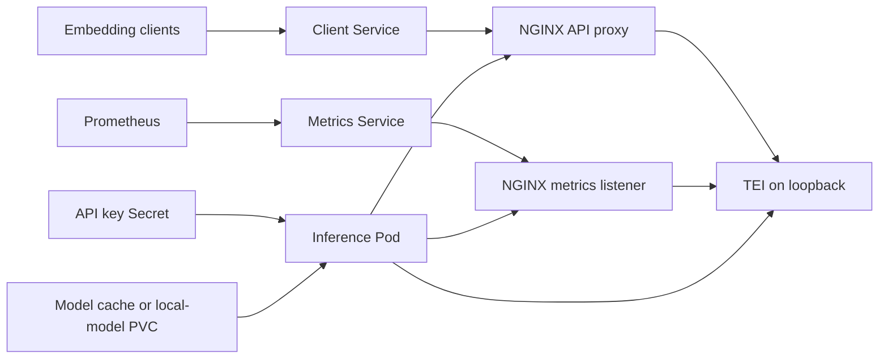

# Text Embeddings Inference design

## Scope

The chart serves HTTP embedding models with the official Hugging Face Text Embeddings Inference image. It manages the
Kubernetes Deployment, controlled proxy boundary, Services, optional model cache, credentials, monitoring resources,
autoscaling, disruption policy and network policy needed to run the inference endpoint.

Native API tests verify real vectors and model identity rather than only checking a TCP socket. The CPU validation
matrix covers generated, existing and External Secrets credentials, cache persistence, local offline artifacts,
metrics, scaling and network controls.

## Architecture

Clients reach a ClusterIP Service and an unprivileged NGINX proxy. NGINX enforces the public API surface and proxies
inference to native TEI on loopback. An optional separate metrics Service reaches a metrics-only NGINX listener. Both
containers run as UID/GID 1000 with read-only root filesystems and writable temporary directories. The Pod has no
Kubernetes API credential.

The proxy and native process share one Pod because the native metrics and API listeners cannot provide the chart's
required path-level security boundary independently. Service selectors target the Pod while named ports keep public
inference and private monitoring traffic distinct.

## Design Decisions

### Reproducibility and persistence

Image digests and Hub commit revisions are independent pins. The default CPU ONNX model is small enough for the
automated cluster and produces meaningful semantic embeddings. Model cache is reproducible, not business data. RWO
cache is restricted to a single Recreate replica. Multiple replicas use independent caches or an explicitly compatible
existing local-model volume. Offline mode selects the local directory, not an environment hint.

### Availability tradeoffs

Recreate is intentionally the default because a model change can alter vector meaning without an HTTP failure.
RollingUpdate is opt-in for compatible contracts. Model and vector-index migrations use distinct releases and indexes.
CPU HPA targets inference CPU only; no unvalidated GPU utilization scaler is included. PDB validation prevents a
singleton budget from obstructing voluntary maintenance. Neither PDB nor graceful termination provides request
durability.

### Native entrypoint

The chart retains the official TEI entrypoint because it performs upstream architecture and CUDA selection. Values are
translated into supported arguments and environment variables without replacing the image bootstrap contract.

## Production Boundary

The chart owns the Kubernetes resources and configuration that start a pinned model server. Operators own model
licensing, Hub availability or offline artifact seeding, vector compatibility, external index migrations, capacity and
GPU scheduling, client retries and timeouts, TLS termination, credential rotation, backup of business indexes, and
rollback criteria. Changing model ID, revision, pooling, prompts or normalization is an application data migration even
when the HTTP API remains healthy.

Each replica loads its own model and consumes its own RAM or VRAM. Horizontal scaling therefore multiplies model memory
and download/cache requirements. Production sizing must use observed request shapes and the selected model rather than
the example defaults.

## Security Boundary

TEI 1.9.4 serves unauthenticated metrics on its HTTP API listener. A declared Prometheus port does not create a private
HTTP exporter in this image. The proxy is therefore a required boundary, not an optional exporter. Public paths deny
metrics and API documentation, and NetworkPolicy separately authorizes metrics clients.

Native INFO startup logging serializes the API key. `LOG_LEVEL` is fixed at `warn` and reserved against override.
Credentials are environment references to Kubernetes Secrets; generated keys use `lookup` during live upgrades.
Declarative render-only installations should use externally managed Secrets. TLS remains an ingress or Gateway
responsibility so the chart does not pretend that pod-local cleartext is an internet-facing security boundary.

## Observability Boundary

Metrics are opt-in and remain private behind the metrics-only proxy and Service. ServiceMonitor and PrometheusRule
resources require an existing Prometheus Operator installation. The default alert detects a missing scrape target; it
does not define model-specific latency, saturation, token, GPU or business-quality objectives. Operators must add
alerts and dashboards that match the chosen model, accelerator and workload.

Application logs and Kubernetes events remain the sources for model download, admission, memory and scheduling
failures. The chart does not ship a log collector or tracing backend.

## Known Gaps

- CUDA manifests preserve upstream setup and request devices, but GPU inference is not validated in the local lab
- autoscaling supports CPU utilization and does not include an unverified GPU or request-queue scaler
- upstream TEI exposes metrics on the native API listener, so privacy depends on the chart proxy and network controls
- first startup can depend on external Hub availability unless a complete local model is mounted
- RWO cache volumes cannot safely back multiple replicas and require the documented single-replica Recreate contract
- the chart cannot determine whether two model revisions produce vectors compatible with an existing external index

## Non-Goals

- providing a vector database, durable work queue or business-data backup system
- training, fine-tuning, evaluating or licensing models
- implementing tenant authorization or application-specific access policy
- creating a gRPC inference service that the pinned upstream image does not expose
- managing cluster GPU drivers, device plugins, ingress controllers, certificate issuers or Prometheus Operator
- automatically migrating or re-embedding an external vector index
