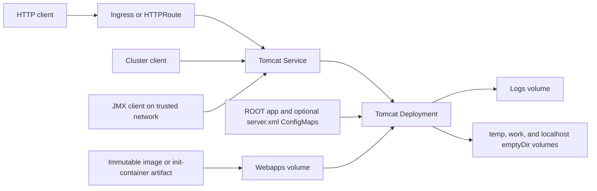

<!-- SPDX-License-Identifier: Apache-2.0 -->

# Apache Tomcat Chart Design

## Scope

The chart deploys the official Apache Tomcat image as a Kubernetes Deployment.
It owns workload identity, Services, health probes, writable runtime paths,
optional persistent webapps and logs, optional routing resources, availability
controls, NetworkPolicy, and Helm tests. It supports applications baked into an
immutable image or delivered by operator-supplied init containers.

The chart does not build Java applications, create Gateway API Gateways, manage
external databases, or configure application-specific sessions, realms,
datasources, certificates, and clustering.

## Architecture

The Service targets the named `http` container port. The official image's
primary Connector listens on `8080`, while `service.ports.http` is an
independent client-facing port. Optional Ingress and HTTPRoute resources route
to the Service rather than directly to Pods.

Tomcat writes beneath `/usr/local/tomcat` even when the application itself is
immutable. The chart therefore mounts explicit writable volumes for webapps,
logs, temp, work, and `conf/Catalina/localhost` while leaving the image root
filesystem read-only.

## Design Decisions

### Fixed process listener and configurable Service port

The official `server.xml` declares the primary HTTP Connector on port `8080`.
The chart constrains `containerPorts.http` to that value instead of pretending a
container metadata change reconfigures Tomcat. Operators may expose any valid
client port through `service.ports.http`. Custom server XML may change proxy
metadata, but the primary Connector must remain on `8080` to preserve the
Service and probe contract.

### Deterministic default application

The upstream image does not guarantee a deployable ROOT application. A small
chart-managed ROOT application provides deterministic `/health.jsp` startup,
readiness, liveness, and Helm test behavior. Production applications should
disable it when they own the ROOT context and point probes at an application
endpoint or use TCP probes.

### Immutable-image preservation

Mounting a volume over `/usr/local/tomcat/webapps` hides image-baked content.
The copy init container preserves that content only when the destination volume
is empty and writes a marker after initialization. This prevents later Pod
starts from overwriting mutable or PVC-backed application state. Immutable
images remain preferred because they provide auditable artifacts and reliable
rollback.

### Routing ownership

The chart can create an Ingress or HTTPRoute, but it does not own an ingress
controller, GatewayClass, or Gateway. Those resources define cluster-wide
policy and remain a platform-team responsibility.

### JMX is explicit

Remote JMX opens a management interface and has separate registry and RMI
connection behavior. It is disabled by default. The chart configures both JVM
ports and advertises either the Pod IP or an operator-provided hostname, while
authentication files, TLS stores, and trusted NetworkPolicy peers remain
explicit production inputs.

## Production Boundary

The chart provides Kubernetes primitives and safe defaults, but production
readiness depends on the deployed application. Operators must supply an
immutable or integrity-verified application artifact, application-specific
probes, resource sizing, external dependencies, TLS termination, backup and
restore procedures, disruption expectations, and a rollout plan.

Persistent webapps are appropriate only when applications are installed or
mutated at runtime. A reused PVC is never refreshed from a newer image. Logs
should normally leave the Pod through the cluster logging pipeline; persistent
log storage is an explicit exception, not a default observability strategy.

Replica safety also depends on application state. Increasing replicas or
enabling HPA does not create shared sessions, distributed caches, or clustered
application storage. Applications must be designed for horizontal scaling
before those controls are enabled.

## Security Boundary

The default workload runs as UID/GID `1001`, requires a non-root user, blocks
privilege escalation, drops all Linux capabilities, uses RuntimeDefault
seccomp, and disables ServiceAccount token automounting. Only documented Tomcat
runtime paths are writable.

NetworkPolicy is opt-in because the chart cannot infer application egress or
the labels of every ingress implementation. Enabling it isolates ingress, but
egress remains unrestricted unless `networkPolicy.egress.enabled` is true or
complete `networkPolicy.egress.extraEgress` rules are supplied. Under egress
enforcement, operators must allow DNS and every application dependency;
ingress rules must allow the ingress controller and trusted JMX clients.
JMX authentication and TLS are not generated because their files and trust
model are environment-specific. Enabling unauthenticated JMX outside a tightly
restricted network is outside the supported production boundary.

Secrets supplied through `tomcat.extraEnv`, `tomcat.extraEnvFrom`, custom
volumes, or application configuration remain operator-managed. The chart does
not copy credentials into ConfigMaps.

## Observability Boundary

Startup, readiness, and liveness probes check the default health JSP or a
configured application path. TCP mode verifies only that the Connector accepts
connections; it does not prove application dependencies are healthy. Helm tests
exercise the same Service path after installation.

Tomcat logs are written to the standard runtime directory, which can be
collected from container output or an optional volume according to platform
policy. JMX supplies JVM and Tomcat management data when enabled, but the chart
does not deploy a JMX exporter, ServiceMonitor, dashboards, alerts, or a logging
agent.

## Upgrade and Lifecycle Model

Chart upgrades roll the Deployment and regenerate checksums for chart-managed
configuration. Image-baked applications follow the image tag selected by the
operator. PVC-backed webapps retain their initialized content and require an
application-owned migration or replacement procedure.

Before upgrading Tomcat, review upstream compatibility, servlet/JSP API
changes, custom `server.xml`, valves, realms, native libraries, and application
dependencies. Back up persistent webapps and logs when they contain recoverable
state, and validate rollback with the same storage objects.

## Validation Design

Unit tests cover the Deployment security context, writable paths, application
seeding, immutable-image copying, HTTP and TCP probes, JMX registry/RMI
behavior, Services, routing, NetworkPolicy, HPA, PDB, and Helm tests. Negative
tests cover required Gateway parents and conflicting JMX Service ports.

CI scenarios render standalone, Ingress, Gateway API, dual-stack, JMX, and
hardening configurations. The canonical release gate adds strict Helm lint,
kubeconform with real CRD schemas, Artifact Hub lint, and behavioral k3d
installation with workload, Service, health, restart, log, and event checks.

## Known Gaps and Limitations

- The primary HTTP Connector is fixed to the official image port `8080`.
- The chart does not validate application-level readiness beyond the configured
  probe path or TCP socket.
- PVC-backed webapps are not refreshed when the image changes.
- JMX authentication, TLS files, and exporter integration are operator-owned.
- Session replication, clustering, and shared application state are not
  configured automatically.
- NetworkPolicy selectors and egress destinations require environment-specific
  values.

## Non-Goals

- Building WAR files, Maven projects, or custom Tomcat images.
- Installing applications from mutable URLs during Pod startup.
- Managing Gateway, ingress-controller, certificate-manager, database, or
  message-broker lifecycles.
- Generating production JMX credentials or trust stores.
- Providing application-specific `server.xml`, realms, datasources, clustering,
  session persistence, or migration logic.
- Replacing centralized metrics, logging, tracing, backup, or disaster-recovery
  systems.
