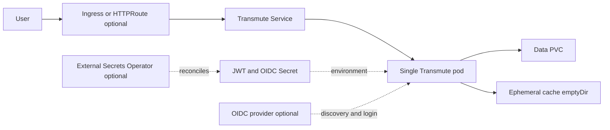

# Transmute Chart Design

## Scope

This chart deploys the official Transmute container as a production-oriented,
single-node file conversion service. It maps only configuration supported by
Transmute v2.1.1 and keeps Kubernetes integration explicit and testable.

The chart owns one Transmute workload and its Kubernetes integration. It does
not own identity providers, routing controllers, storage infrastructure, Secret
stores, backup systems, or the lifecycle of an existing PVC.

## Architecture

All durable application state flows through one PVC. The Service is the stable
in-cluster endpoint, while Ingress and Gateway API routes remain optional
platform integrations.

## Main Design Choices

Transmute keeps its SQLite database, user records, job state, uploaded inputs and
generated outputs below `DATA_DIR`. Those components are not designed for shared,
concurrent writes by horizontally scaled application pods.

The chart consequently treats these as invariants:

1. `replicaCount` is exactly one.
2. `persistence.enabled` is true.
3. The Deployment strategy is `Recreate`.
4. One stable `AUTH_SECRET_KEY` signs JWTs across restarts and upgrades.

Both JSON Schema and template validation reject unsafe value combinations.

The chart also separates the application listener (`containerPorts.http`) from
the Service port, preserves a generated JWT key through `lookup`, and exposes
canonical Kubernetes extension points without manufacturing unsupported
Transmute settings.

## Storage

A single PVC is mounted at `persistence.mountPath`, which defaults to `/app/data`
and matches `config.dataDir`. An existing claim can be attached for restore or
migration. The chart deliberately does not advertise an online, application-aware
backup API; snapshots or file-level copies must be taken while writes are stopped.

## Authentication

Transmute generates a random JWT signing key when none is supplied, but an
application-generated key changes at every restart. The chart instead owns a
Kubernetes Secret, preserves the generated 64-character value through Helm
upgrades with `lookup`, and injects it as `AUTH_SECRET_KEY`.

The upstream application has no initial-administrator environment variables. The
first user registered on an empty database becomes administrator. The chart does
not emulate unsupported bootstrap behavior.

## OIDC

OIDC is activated by the upstream tuple `APP_URL`, `OIDC_ISSUER_URL`,
`OIDC_CLIENT_ID` and `OIDC_CLIENT_SECRET`. `OIDC_INTERNAL_URL` optionally separates
browser-facing redirects from cluster-internal discovery and token exchange. The
callback is always `<APP_URL>/api/oidc/callback`; scopes are fixed upstream.

The OIDC client secret shares the application Secret interface so it can be
supplied inline, from an existing Secret or through External Secrets Operator.

## Security Boundary

The pod and container run as UID/GID 1000 with runtime-default seccomp,
privilege escalation disabled and all Linux capabilities dropped. The root
filesystem is read-only. A memory-independent `emptyDir` mounted at `/tmp`
provides writable font and conversion caches through `HOME` and `XDG_CACHE_HOME`.
Durable writes remain on the PVC.

The ServiceAccount token is not mounted. NetworkPolicy is opt-in because OIDC and
conversion integrations can require provider-specific DNS and external egress.

The chart hardens the container boundary but does not inspect uploaded files,
conversion payloads, OIDC claims, or custom environment variables. Operators
remain responsible for authenticating external access, limiting upload size,
reviewing converter exposure, and controlling network paths to identity and
integration endpoints.

## Production Boundary

The chart owns the Deployment, Service, chart-created PVC and authentication
Secret, and any enabled routing, NetworkPolicy, ExternalSecret, or ServiceAccount
resources. The platform owns DNS, TLS and certificates, ingress or Gateway
controllers, storage classes and snapshots, External Secrets Operator and its
SecretStore, the OIDC provider, and externally supplied Secrets or PVCs.

Production deployments must keep one replica, preserve the authentication
Secret with the data volume, size the PVC and memory for conversion workloads,
and accept a short outage during `Recreate` upgrades. Backups must quiesce
application writes before copying SQLite and file state.

## Observability Boundary

Kubernetes startup, readiness, and liveness probes cover the upstream health
endpoints. Application and conversion logs are emitted through the container,
and `helm test` verifies Service connectivity. The chart does not install a log
collector, metrics exporter, dashboard, alert rules, or external availability
monitor.

A ready pod proves that the health endpoint responds and the Service has a
backend. It does not prove that every conversion format succeeds, that the OIDC
provider is reachable, or that the PVC has enough capacity for a new job.

## Supported integrations

- Ingress using `ingress.ingressClassName`;
- Gateway API v1 HTTPRoute with multiple route definitions;
- IPv4, IPv6 and dual-stack Services;
- External Secrets Operator using complete `items[].spec` objects;
- custom environment variables and volumes for upstream-compatible extensions.

## Known Gaps And Operational Risks

- SQLite and a ReadWriteOnce data volume prevent horizontal high availability.
- `Recreate` upgrades deliberately introduce a service interruption.
- Generated keys are preserved by looking up the live Kubernetes Secret. A
  normal Helm uninstall deletes that Secret, so reinstalling without a backup
  or an externally managed Secret generates a new key and invalidates sessions.
- Conversion workloads can exhaust memory, temporary space, or persistent
  capacity even while health probes remain green.
- NetworkPolicy egress isolation requires complete DNS, OIDC, and integration
  allow rules supplied by the operator.
- File-level backups are consistent only after application writes stop.

## Explicit Non-Goals

- horizontal scaling or high availability for the local SQLite application;
- installing an identity provider, Gateway controller, CSI driver or ESO;
- claiming generic GPU acceleration without explicit upstream device support;
- manufacturing unsupported registration, administrator or OIDC scope settings.
