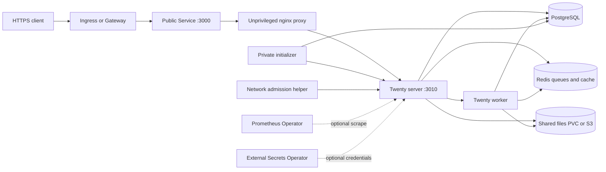

# Twenty chart design

## Scope

This chart deploys a production-oriented, single-replica Twenty CRM workspace. It owns the native server, worker,
public proxy, private initialization flow, retained application identity, and optional HelmForge PostgreSQL and Redis
dependencies. It also renders the Kubernetes resources needed for ingress, Gateway API, network isolation, metrics,
external secrets, persistence, and recovery validation.

The contract deliberately prioritizes deterministic first enrollment, migration safety, retained identity, private
native ports, and recoverable state over horizontal scaling.

## Architecture

One `Recreate` Deployment Pod contains the native server, worker, public proxy, private initializer, and network
admission helper. The server and worker share retained files. PostgreSQL stores workspace records and migrations; Redis
stores cache, PubSub, and durable BullMQ work. The proxy is the only application port exposed by the Service.

The initializer completes strict native migrations and administrator/workspace enrollment before public startup. The
admission helper verifies each Pod address family under an enforcing CNI before the native wildcard listener starts.
This is bounded network evidence with trusted namespace policy ownership, not proof of universal isolation.

## Design decisions

### Single Recreate Pod

Twenty migrations, local files, enrollment, and worker ownership must remain serialized. A `Recreate` Deployment keeps
those operations in one failure domain and prevents two application Pods from racing over retained identity. This
chart therefore fixes `replicaCount` at one and makes no high-availability claim.

### Native enrollment instead of database mutation

Native configuration is environment-owned with `IS_CONFIG_VARIABLES_IN_DB_ENABLED=false`. Enrollment uses Twenty
authentication and workspace mutations instead of SQL password or privilege writes. Command success requires both exit
status and native completion evidence because upstream commands can swallow errors.

The ownership marker follows native user and workspace IDs across password changes. An existing database without the
matching marker is rejected before migration, preventing accidental adoption of unrelated state.

### Retained identity is a coordinated state set

`SERVER_ID`, `ENCRYPTION_KEY`, the ownership marker, the database, application files, and Redis queues form one recovery
unit. Restoring only a subset can invalidate sessions, encryption, pending work, or file references. Generated private
initialization diagnostics use a mode-0600 file that is removed after success.

### PostgreSQL and Redis dependencies remain replaceable

The default topology uses HelmForge PostgreSQL and authenticated persistent Redis subcharts. Each dependency can be
replaced by an external TLS endpoint with certificate and hostname verification. Redis uses append-only persistence and
`noeviction` because it contains durable queue state, not only disposable cache entries.

### Public traffic is proxied

The Service targets the unprivileged nginx proxy on port 3000. The native server stays private on port 3010. The helper
tests actual native-port isolation before startup, so a manifest that accidentally exposes the native listener fails
behavioral validation.

## Production boundary

The chart provides a single Twenty application Pod, persistent or external PostgreSQL and Redis, retained application
identity, optional local or S3 file storage, HTTPS edge integration, authenticated SMTP, and Prometheus integration.
Default resource requests and limits bound every chart-owned container, and writable paths use PVCs or size-limited
`emptyDir` volumes.

Production operators must provide an HTTPS hostname, durable StorageClasses or external services, backups, an enforcing
CNI, and explicit NetworkPolicy peers for every external dependency. The chart does not install an ingress controller,
Gateway controller, cert-manager, External Secrets Operator, Prometheus Operator, SMTP server, S3 service, or backup
platform.

Recreate deployment serializes migrations and local storage access. It also means a rollout has an availability gap.
Horizontal scaling is outside the supported topology even when PostgreSQL, Redis, or S3 are external.

## Security boundary

Application and helper Pods are tokenless and run as UID/GID 1000 with read-only image filesystems, dropped Linux
capabilities, no privilege escalation, and `RuntimeDefault` seccomp. Explicit writable volumes cover native SDK output,
temporary files, nginx runtime state, and dependency sockets.

NetworkPolicy is enabled by default. Same-namespace ingress is the default trust boundary, while egress permits only
DNS and explicitly selected dependencies. Public HTTPS egress is opt-in. NetworkPolicy effectiveness depends on the CNI
and cluster administrators retaining ownership of namespace labels and policy admission.

Secrets can be generated, supplied through existing Kubernetes Secrets, or reconciled by External Secrets Operator.
The chart never treats an example password as production material. Temporary signed download URLs are bearer
capabilities and must be handled accordingly. Browser-to-bucket presigned upload is disabled so file authorization stays
behind the application.

## Observability boundary

Startup, readiness, and liveness probes distinguish initialization, dependency readiness, and a stopped native listener.
The server alone exports Prometheus metrics on private port 9464. Optional ServiceMonitor and availability rules require
explicit network ingress. The co-located worker does not bind a second metrics exporter; its readiness proves
registration, while behavioral acceptance verifies a completed native job and its stored SDK archive.

Runtime validation checks administrator/workspace enrollment, closed public signup, record and attachment operations,
native worker jobs, Pod replacement, network isolation, external dependencies, SMTP recovery, S3 bytes, metrics, and
coordinated restore. Kubernetes probes and metrics do not replace those application-level acceptance tests.

## Storage and recovery

Local files share one PVC between the native server and worker. S3 changes file placement, while the PVC still retains
installation ownership. A valid recovery point coordinates PostgreSQL, Redis, files, and the identity Secret. The
restore scenario uses fresh database and PVC resources, verifies retained sessions and bytes, and requires previously
pending native work to finish after recovery.

See [retained state and recovery](docs/retained-state.md), [storage](docs/storage.md), and
[dependency hardening](docs/dependencies.md) for operational procedures.

## Known gaps and limitations

- The supported application topology is one Pod and has no horizontal scaling or zero-downtime rollout guarantee.
- Restrictive custom Redis ACLs need deployment-specific compatibility tests.
- SMTP support is intentionally limited to authenticated implicit TLS on port 465 because that matches the tested native
  transport.
- S3 is application file storage, not a database, Redis, identity, or backup solution.
- Network admission proves the tested CNI path and address families only; it cannot attest to every cluster networking
  implementation.
- Native and dependency image vulnerability review remains a release-operations responsibility outside rendered-manifest
  scanning.

## Non-goals

- Operating a multi-replica or globally distributed Twenty deployment.
- Installing or managing cluster-wide edge, certificate, secrets, monitoring, mail, object-storage, or backup systems.
- Enabling licensed SSO, third-party account synchronization, AI providers, or hosted function execution.
- Mutating existing administrator passwords or workspace privileges directly in PostgreSQL.
- Treating Redis queues, S3 files, or a PVC snapshot as a complete recovery point in isolation.
