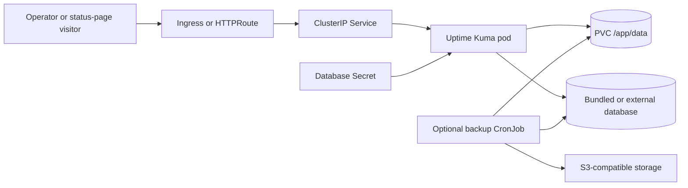

<!-- SPDX-License-Identifier: Apache-2.0 -->

# Uptime Kuma Chart Design

## Scope

This chart deploys one Uptime Kuma instance for uptime monitoring, public status
pages, and notifications. It supports SQLite on a persistent volume, a bundled
MariaDB-compatible database through HelmForge MySQL, or an external
MariaDB-compatible service.

## Architecture

The database paths are mutually exclusive. SQLite is the default and keeps all
state under `/app/data`. MariaDB mode uses either the optional MySQL dependency
or an explicitly configured external host. The backup CronJob selects tar or
`mysqldump` from that same database contract.

## Design Decisions

- Use the official `louislam/uptime-kuma` image with an immutable release tag.
- Keep SQLite as the default because it follows upstream behavior and avoids a
  mandatory stateful dependency.
- Keep replicas fixed at one because Uptime Kuma does not coordinate monitor
  execution or WebSocket state across horizontally scaled application pods.
- Use `Recreate` so two application pods do not write the same SQLite volume.
- Keep the application listener separate from `service.port`, with the Service
  targeting the named application port.
- Trigger application rollouts when the database credential reference or inline
  value contract changes.
- Keep Ingress, Gateway API, External Secrets, NetworkPolicy,
  PodDisruptionBudget, and S3 backup features opt-in.

## Production Boundary

The chart owns Kubernetes resources for the application, optional bundled
database, exposure, credentials, and backup scheduling. Operators remain
responsible for durable storage classes, resource sizing, ingress authentication
and TLS policy, external database lifecycle, S3 retention, monitor-target access,
and tested disaster recovery.

A PodDisruptionBudget can reduce voluntary disruption but cannot make a
single-replica process highly available. Production maintenance plans must allow
for a controlled outage and verify that the PVC or external database is durable.

## Security Boundary

The application and backup workloads use runtime-default seccomp, deny privilege
escalation, drop all Linux capabilities, keep the image root filesystem
read-only, and write temporary state only to bounded `emptyDir` volumes.
Service-account token automounting defaults to false. NetworkPolicy is optional
because required egress varies with monitor targets and notification services.

The official standard Uptime Kuma image starts as UID 0, so the chart does not
set `runAsNonRoot` or claim a non-root boundary it cannot guarantee. The remaining
container controls materially restrict that process, but cluster admission,
node isolation, and network policy remain part of the platform boundary.
Credentials should come from existing Secrets or External Secrets in production;
inline values remain available for development and CI.

## Observability Boundary

Startup, readiness, and liveness probes verify the HTTP endpoint. Operators can
inspect application and backup logs, Kubernetes events, CronJob history, PVC
state, and routing status. Uptime Kuma is the monitoring application itself; this
chart does not install a separate metrics exporter, ServiceMonitor, log backend,
or alerting stack.

## Known Gaps and Limitations

- Uptime Kuma remains single-replica with no active-active topology.
- SQLite cannot be migrated automatically to MariaDB by the chart.
- The standard upstream image is not non-root.
- Backup completion proves upload, not restore correctness; operators must run
  restore drills.
- An empty enabled NetworkPolicy direction denies all traffic in that direction;
  the chart cannot infer monitor targets, notification endpoints, DNS, S3, or
  external database destinations.
- The chart does not rotate application, database, or S3 credentials.

## Non-Goals

- Installing or operating an external database service
- Installing Gateway API CRDs, an ingress controller, or External Secrets Operator
- Automatic monitor export/import or SQLite-to-MariaDB migration
- Multi-replica Uptime Kuma coordination
- Defining organization-specific backup retention and restore objectives

## Validation

The required `make validate-chart CHART=uptime-kuma` gate covers dependency
resolution, strict Helm lint, default and CI rendering, helm-unittest,
kubeconform against the relevant CRD schemas, Artifact Hub lint, and behavioral
k3d installation. Runtime profiles exercise SQLite, bundled MySQL, external
database, backup, Ingress, Gateway API, External Secrets, and dual-stack
rendering. Tests also cover fail-fast configuration contracts and the default
security posture.

<!-- @AI-METADATA
type: design
title: Uptime Kuma Chart Design
description: Architecture, production, security, observability, and validation boundaries for the Uptime Kuma chart.
keywords: uptime-kuma, monitoring, sqlite, mariadb, gateway-api, external-secrets, backup
purpose: Document chart architecture, operational boundaries, and validation expectations.
scope: Chart Design
relations:
  - charts/uptime-kuma/README.md
  - charts/uptime-kuma/docs/database.md
  - charts/uptime-kuma/docs/backup.md
path: charts/uptime-kuma/DESIGN.md
version: 2.0
date: 2026-10-25
-->
