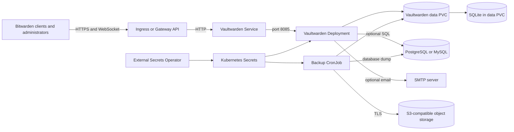

# Vaultwarden Chart Design

This document defines the architecture, operating boundaries, and deliberate
trade-offs of the HelmForge Vaultwarden chart.

## Product Goal

Provide a secure, explicit single-instance Vaultwarden deployment with durable
application state, selectable database backends, ingress or Gateway API
exposure, secret-backed credentials, and verifiable backup workflows.

The chart favors a small and predictable Kubernetes contract over a generic
application wrapper. It exposes operational settings that materially affect
Vaultwarden security, persistence, networking, email, or recovery.

## Scope

Included:

- one Vaultwarden Deployment and one HTTP Service
- a PVC for `/data`, enabled by default
- SQLite, external PostgreSQL/MySQL, or bundled HelmForge database subcharts
- Ingress and Gateway API HTTPRoute exposure
- SMTP, admin-token, and database credentials from Kubernetes Secrets
- External Secrets Operator integration for the admin credential
- optional NetworkPolicy ingress and egress isolation
- database-aware backup CronJob with S3-compatible object storage
- restore through an existing claim or deliberate PV selector

Excluded:

- multi-replica or active-active Vaultwarden
- database failover orchestration
- automatic database-engine migrations
- automatic identity-provider provisioning
- management of ingress controllers, Gateways, certificate issuers, object
  stores, SMTP servers, or External Secrets stores

## Architecture



The Kubernetes Service remains on port 80 while Rocket listens on the
configurable non-privileged `service.targetPort`, which defaults to 8085. HTTP
and WebSocket traffic share the same listener and route.

## Design Decisions and Trade-offs

### Single application replica

Vaultwarden is intentionally rendered with one replica. `/data` contains
runtime state even when SQL stores the primary vault records, and the chart
does not claim that a shared database alone makes the application stateless or
highly available. A Deployment is sufficient because the pod does not require
a stable ordinal identity.

### Persistent data boundary

The entire `/data` directory is durable by default. It includes SQLite data,
attachments, sends, generated keys, icons, and persisted `config.json` state.
Backup and restore guidance therefore treats `/data` as a unit rather than
copying only `db.sqlite3`.

### Database selection

`database.mode` validates one effective backend. In `auto` mode, an external
database wins over the PostgreSQL subchart, which wins over the MySQL subchart,
with SQLite as the fallback. Ambiguous combinations fail during rendering.
Database passwords must be explicit so generated connection URLs are stable
across upgrades.

### Non-root listener

The upstream image commonly defaults Rocket to privileged port 80. This chart
runs as UID/GID 1000 and drops all capabilities, so it exports
`ROCKET_ADDRESS=0.0.0.0` and derives `ROCKET_PORT` from `service.targetPort`.
This preserves a Service port of 80 without granting `NET_BIND_SERVICE`.

### Backup execution

The backup CronJob selects a SQLite archive, PostgreSQL dump, or MySQL dump
from the effective database mode, then uploads through the pinned HelmForge
MinIO Client image. A private S3 CA is mounted explicitly; disabling TLS
verification is an opt-in emergency escape hatch and cannot be combined with a
CA Secret.

## Production Boundary

The chart owns the Vaultwarden workload, Service, optional PVC, routing
resources, optional NetworkPolicy, generated Secrets, ExternalSecret, and
backup resources. Operators own:

- the Kubernetes cluster, CNI, ingress controller or Gateway implementation
- DNS, TLS certificates, and the correctness of the public `domain`
- external databases and their availability, encryption, and backups
- object-storage retention, versioning, encryption, and restore testing
- SMTP delivery and reputation
- Secret and External Secrets backends
- resource sizing, alerting, maintenance windows, and disaster-recovery drills

A successful Helm rollout does not prove that external email, database, or
object-storage dependencies satisfy production requirements.

## Security Boundary

The default application pod runs as non-root, denies privilege escalation,
drops all capabilities, and uses `RuntimeDefault` seccomp. Application and
backup pods disable Kubernetes API credential automounting because neither
workload calls the API.

The admin token, SMTP password, database URL, and S3 credentials are sensitive.
Production deployments should use existing Secrets or External Secrets and an
Argon2 PHC admin token. The chart does not protect secrets placed directly in
Helm values from release-history exposure.

TLS terminates at the selected edge by default. NetworkPolicy is optional
because enforcement depends on the cluster CNI; enabling egress isolation
requires explicit DNS, database, SMTP, and object-storage destinations. The
admin endpoint remains part of the application route and must be restricted by
the operator's edge and identity controls.

## Observability Boundary

Startup, readiness, and liveness probes call the Vaultwarden `/alive` endpoint,
including a configured domain path prefix. Runtime validation checks rollout,
Service endpoints, authenticated and anonymous behavior, persistence after pod
replacement, logs, restarts, and Kubernetes Warning events.

Vaultwarden does not expose a chart-managed Prometheus contract here. Operators
must collect container logs, Kubernetes workload metrics, ingress metrics,
database health, SMTP failures, backup CronJob status, and object-store upload
results through their platform. The chart intentionally avoids creating a
ServiceMonitor without a stable upstream metrics endpoint.

## Known Gaps and Limitations

- one application replica creates an availability boundary during upgrades
- SQLite is not an HA database and uses the same PVC as other runtime state
- the backup CronJob is not a continuous or transactional multi-system backup
- SQL-mode backups still require `/data` protection for attachments and keys
- NetworkPolicy cannot secure traffic on CNIs that do not enforce it
- `readOnlyRootFilesystem` is not enabled because the pinned upstream image
  still expects writable runtime paths outside the mounted data directory
- External Secrets automation currently targets the admin credential; other
  external credentials use operator-created Kubernetes Secrets

## Non-Goals

- turning Vaultwarden into a horizontally scalable service
- operating PostgreSQL, MySQL, S3, SMTP, DNS, or TLS infrastructure
- silently choosing between conflicting database sources
- compiling or mutating the upstream image at startup
- claiming backup success without a tested restore

## Validation Contract

The chart must keep positive unit coverage for every rendered resource and
negative coverage for fail-fast validation. CI renders all scenarios and runs
strict lint, kubeconform, Artifact Hub lint, and behavioral k3d validation for
SQLite, bundled and external databases, routing, External Secrets, SMTP,
backup, restore, network isolation, and custom listener behavior.

The definitive gate is:

```bash
make validate-chart CHART=vaultwarden
```
