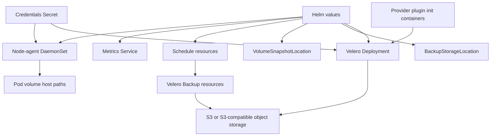

<!-- SPDX-License-Identifier: Apache-2.0 -->

# Velero Chart Design

## Scope

The Velero chart installs the upstream Velero server with the official
`docker.io/velero/velero` image, optional provider plugin init containers,
Velero CRDs, backup storage locations, snapshot locations, schedules, metrics,
and the optional node-agent DaemonSet for filesystem backup.

The chart is intentionally explicit about storage and credentials. Operators
must provide a working object storage bucket and credentials before depending on
the release for disaster recovery.

## Architecture

## Design Choices

### Official upstream images

The chart uses the official Velero server image and the official AWS provider
plugin image by default. Additional plugin init containers are exposed through
`plugins.extra` so users can add provider-specific integrations without the
chart inventing provider abstractions.

### CRDs are packaged with the chart

Velero is CRD-driven. The chart keeps Velero CRDs in `crds/` so Helm installs
them before rendering `BackupStorageLocation`, `VolumeSnapshotLocation`, and
`Schedule` resources.

### Object storage is mandatory for useful backups

Velero backups are stored through `BackupStorageLocation` resources. The
default values render a placeholder S3-compatible configuration and require the
operator to provide a bucket, endpoint when needed, and credentials.

### Filesystem backup is opt-in

Velero filesystem backup requires the node-agent DaemonSet. The official Velero
documentation describes node-agent as the component that hosts filesystem backup
modules such as Kopia. This chart keeps it disabled by default because it needs
hostPath access to pod volume directories and runs as root by design.

### Snapshots stay provider-specific

`VolumeSnapshotLocation` resources are rendered from values, but the chart does
not infer cloud provider configuration. Snapshot support depends on the
installed Velero plugin and storage platform capabilities.

## Production Boundary

- Validate `BackupStorageLocation` health before enabling schedules.
- Enable `nodeAgent.enabled` only after confirming hostPath and Pod Security
  expectations for the target cluster.
- Use `configuration.defaultVolumesToFsBackup=true` only when filesystem backup
  should be the default for pod volumes.
- Keep DR clusters in `configuration.restoreOnlyMode=true` when they should not
  create new backups.
- Set resource requests and limits based on backup concurrency and repository
  size.
- Treat inline `credentials.secretContents` as a bootstrap path; production
  environments should prefer a pre-created Secret or platform secret manager
  workflow.

## Security Boundary

The server and default AWS plugin run as the non-root identities declared by
their official images. Their containers drop all Linux capabilities, disallow
privilege escalation, use a read-only root filesystem, and run with the
RuntimeDefault seccomp profile. The server keeps writable `emptyDir` volumes at
`/scratch`, `/plugins`, and `/tmp` because Velero and its plugin processes need
those paths at runtime.

The node-agent is a deliberate exception. Filesystem backup needs access to
kubelet host paths and therefore runs as UID 0. Its container remains
unprivileged, drops all capabilities, disallows privilege escalation, and uses
a read-only root filesystem. Operators must evaluate that host access against
their Pod Security and node isolation policies before enabling it.

Velero is a Kubernetes controller and needs an API token plus cluster-scoped
RBAC. The default ClusterRoleBinding targets `cluster-admin`; installations
with stricter authorization requirements can set
`rbac.clusterAdministrator=false` and manage an appropriate binding outside
the chart. Credentials are mounted from a Secret and are never placed in
command-line arguments.

The default NetworkPolicy limits inbound traffic to the metrics listener while
leaving egress open because the controller must reach the Kubernetes API and
operator-selected object storage endpoints. Restricting egress further is an
operator responsibility because those destinations are environment-specific.

## Observability Boundary

Velero exposes metrics through the chart-managed Service when `metrics.enabled`
is true. `metrics.serviceMonitor.enabled` creates a Prometheus Operator
ServiceMonitor when that CRD is available in the cluster.

Operational signals to watch:

- `BackupStorageLocation` availability
- backup and restore phase transitions
- node-agent readiness on nodes that host protected PVCs
- failed or partially failed backups
- repository maintenance and upload/download failures
- schedules creating backups at the expected cadence

The chart exposes only the Velero Prometheus endpoint. It does not install a
Prometheus stack, define alerts, or infer backup success from scrape health.
The process listener (`metrics.containerPort`) is independent from the Service
port (`metrics.service.port`), and the Service always targets the named
`metrics` container port.

## Failure Domains

| Failure Domain | Chart Boundary | Operator Responsibility |
|----------------|----------------|-------------------------|
| Object storage outage | BSL resource renders provider config | operate durable bucket and endpoint |
| Credential rotation | Secret reference or inline Secret | rotate credentials and restart Velero if required |
| PVC data protection | node-agent DaemonSet | enable filesystem backup or snapshots deliberately |
| Snapshot provider drift | VSL resource renders provider config | install and maintain matching Velero plugin |
| Schedule scope mistakes | Schedule resource renders template | review namespaces, selectors, TTL, and volume mode |

## Non-Goals

- Installing object storage such as MinIO.
- Installing Prometheus Operator.
- Managing cloud IAM identities.
- Creating backup buckets.
- Generating provider credentials.
- Abstracting every Velero provider into first-class values.

## Gaps

- NetworkPolicy egress is permissive by default because Kubernetes API and
  object-storage destinations cannot be inferred portably.
- The chart does not create provider IAM identities, cloud buckets, encryption
  keys, or external secret synchronization resources.
- Enabling `metrics.serviceMonitor` requires Prometheus Operator CRDs to exist
  before Helm renders the release.
- Backup and restore correctness depends on provider plugins, storage health,
  and application-consistent hooks that are outside this chart's control.
- The node-agent cannot run as non-root while it requires kubelet host-path
  access for filesystem backup.

## References

- [Velero documentation](https://velero.io/docs/)
- [File System Backup](https://velero.io/docs/main/file-system-backup/)
- [Backup Storage Locations and Volume Snapshot Locations](https://velero.io/docs/main/locations/)
- [Customize Velero Install](https://velero.io/docs/main/customize-installation/)
