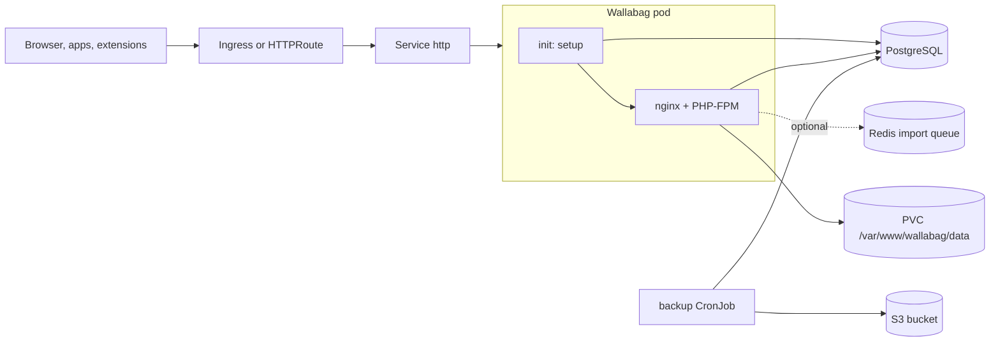

<!-- SPDX-License-Identifier: Apache-2.0 -->
# Wallabag Chart Design

Design notes for the HelmForge `wallabag` chart. Wallabag is a self-hosted
read-it-later application: it saves web pages, strips them down to readable
content, and serves them through a web UI, a REST API, mobile apps, and browser
extensions.

## Scope

The chart deploys one Wallabag instance backed by PostgreSQL:

- a single-replica Deployment running the official `wallabag/wallabag` image;
- a setup init container that installs the schema on first start and applies
  Doctrine migrations on every later start;
- a ClusterIP Service, plus optional Ingress or Gateway API HTTPRoutes;
- a `ReadWriteOnce` PVC for `/var/www/wallabag/data`;
- the HelmForge PostgreSQL subchart or an external PostgreSQL server;
- optional Redis wiring for the asynchronous import queue;
- an optional CronJob that uploads `pg_dump` archives to S3-compatible storage.

## Architecture

The upstream image starts `/entrypoint.sh` as root. The entrypoint renders
`app/config/parameters.yml` from `SYMFONY__ENV__*` variables, runs
`composer install` as `nobody`, and hands control to `s6-svscan`, which
supervises nginx and PHP-FPM. PHP-FPM listens on `127.0.0.1:9000`; nginx serves
the public listener.

## Design Choices

- **Chart-owned database setup.** With PostgreSQL, the upstream entrypoint only
  runs `wallabag:install` when it receives superuser credentials and the
  database does not exist yet. The HelmForge PostgreSQL subchart and managed
  databases pre-create the database, so the entrypoint never installs the
  schema. The `setup` init container checks for `wallabag_internal_setting`:
  when it is missing, it runs `wallabag:install`; otherwise it runs
  `doctrine:migrations:migrate --allow-no-migration`, which is the upstream
  upgrade procedure.
- **Initial super-admin from a Secret.** `wallabag:install` always creates the
  `wallabag/wallabag` account. Before a first install, the setup container
  creates the `helmforge_admin_pending` sequence. While it exists, every start
  renames the upstream account to `wallabag.admin.username` (or creates that
  super-admin with `fos:user:create` when the installer left no user), sets its
  email, applies the password from `<release>-wallabag-admin` (or
  `wallabag.admin.existingSecret`), and then drops the sequence. The marker is
  written before the installer, so an interrupted install is completed on the
  next start, and databases installed outside the chart are left untouched. It
  is a sequence because the installer skips schema creation when any table
  already exists.
- **Stable generated secrets.** The Symfony secret and the admin password are
  generated once and read back with `lookup` on upgrades, so sessions and
  credentials do not rotate on `helm upgrade`. Tools that render without
  cluster access, such as `helm template`, generate new values on each render;
  set `wallabag.existingSecret` and `wallabag.admin.existingSecret` for GitOps.
- **Real listener port.** `wallabag.port` rewrites the nginx `listen`
  directive before the entrypoint starts and fails the container when the
  rewrite does not apply. The Service port is independent and targets the
  named `http` container port.
- **HTTP probes.** All probes call `/api/info`, which goes through nginx,
  PHP-FPM, and the Doctrine-backed configuration. A TCP probe stayed green while
  the application returned HTTP 500 because the schema was missing.
- **PostgreSQL only.** Upstream also supports MySQL and SQLite. The chart
  standardizes on PostgreSQL so the backup CronJob and the setup logic have one
  tested path.
- **Single replica with Recreate.** The data directory is `ReadWriteOnce` and
  holds downloaded article images, so the Deployment runs one replica and uses
  the `Recreate` strategy.

## Production Boundary

- Back up PostgreSQL with `backup.enabled=true` or with the managed database
  provider. The PVC holds downloaded article images; restoring the database
  recovers entries, tags, and annotations, and images are fetched again when an
  entry is reloaded and the source page is still available.
- Set `wallabag.domainName` to the exact public URL. Wallabag uses it to build
  absolute links in exports, the API, and emails.
- Provide `wallabag.existingSecret` and `wallabag.admin.existingSecret` when
  manifests are rendered outside the cluster.
- Size `resources` for PHP-FPM. Imports of large archives run synchronously in
  the web request unless an import worker consumes the Redis queue.

## Security Boundary

- The upstream image must start as root: the entrypoint writes into the
  application tree, nginx binds the listener, and both processes switch to
  unprivileged users. `runAsNonRoot` and `readOnlyRootFilesystem` are therefore
  not supported.
- Defaults still remove what the image does not need: `allowPrivilegeEscalation:
  false`, all capabilities dropped except `CHOWN`, `DAC_OVERRIDE`, `FOWNER`,
  `SETGID`, `SETUID`, and `NET_BIND_SERVICE`, the `RuntimeDefault` seccomp
  profile, and `automountServiceAccountToken: false`.
- `fsGroup: 65534` makes a fresh data volume writable by the `nobody` PHP user.
- Database, Redis, Symfony, admin, and S3 credentials are read from Secrets.
  Every credential accepts an existing Secret.
- Public registration is disabled by default (`wallabag.registration=false`).

## Observability Boundary

- Probe status reflects application health through `/api/info`.
- nginx access logs and PHP errors go to the `wallabag` container output; setup
  and migration output goes to the `setup` init container.
- Wallabag exposes no Prometheus endpoint, so the chart renders no
  ServiceMonitor. Monitor the HTTP endpoint and PostgreSQL instead.

## Current Gaps and Improvement Candidates

- No import worker Deployment. Redis is wired into the configuration, but the
  queue is consumed only by `wallabag:import:redis-worker <type>` processes,
  which the chart does not run. Keep the Wallabag internal setting "Enable Redis
  to fetch data asynchronously" disabled unless you run workers yourself.
- No NetworkPolicy or ExternalSecret templates. Use `extraManifests` or
  platform-level policies.
- The admin password applies only to the first install. Later changes go
  through the Wallabag UI or `fos:user:change-password`.

## Explicit Non-Goals

- Horizontal scaling or HA of the application tier.
- MySQL, MariaDB, or SQLite storage.
- Managing Wallabag internal settings or users beyond the initial super-admin.
- Rebuilding the image to run without root.
