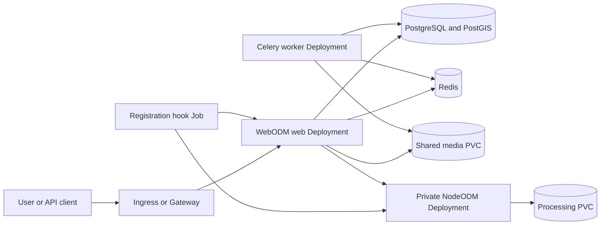

<!-- SPDX-License-Identifier: Apache-2.0 -->

# WebODM Chart Design

## Scope

This chart deploys a self-hosted WebODM control plane, Celery workers, and an
optional private NodeODM processing engine. It supports bundled or external
PostgreSQL/PostGIS and Redis, persistent application and processing data,
Ingress or Gateway API exposure, OIDC, External Secrets Operator resources,
CPU or NVIDIA GPU processing, and network isolation. The design favors an
operable single-cluster installation while keeping every upstream image
official, versioned, and digest pinned.

## Architecture

The web Deployment is deliberately a singleton with a `Recreate` strategy.
The upstream startup script performs database migrations, synchronizes grids,
starts periodic schedulers, and launches NGINX and Gunicorn. Overlapping web
pods could therefore run migrations or schedulers concurrently. Celery workers
are separate and may scale, but every worker must see the same media files.
The chart requires `ReadWriteMany` media storage when more than one worker is
configured and otherwise co-locates the worker with the web pod for the default
`ReadWriteOnce` claim.

Before invoking the upstream startup script, the web wrapper applies migrations
and runs WebODM's idempotent boot routine once. This creates the singleton
settings and default theme before the startup script's first internal HTTP
request, avoiding an upstream first-request race that otherwise emits a
traceback. The upstream script repeats migrations safely and remains the owner
of schedulers, NGINX, and Gunicorn startup. WebODM 3.3.1 exports `WO_PORT` but
ships NGINX templates with port `8000` embedded in their `listen` directives.
The wrapper replaces only those listener literals with the validated
`web.containerPort` value before the upstream script renders the templates.
This keeps both plain HTTP and optional TLS listeners aligned with the pod and
probe contract without replacing the upstream process manager.

NodeODM is registered after install and upgrade by a hook Job. The Job waits
for PostgreSQL, WebODM, and the authenticated NodeODM `/info` endpoint before
calling `manage.py addnode`. Its Service is always ClusterIP and has no public
exposure template. The HTTP listeners are independent contracts:
`web.containerPort` configures the upstream WebODM NGINX process through
`WO_PORT`, while `processing.containerPort` is passed to NodeODM's `--port`.
The public Service ports remain independently configurable and use named
`targetPort` values.

## Design decisions

### Official images and immutable resolution

The chart uses the official `webodm/webodm_webapp` and
`opendronemap/nodeodm` images. Tags communicate the upstream version and
digests make the selected manifests immutable. The bundled database uses the
official PostGIS image through the maintained HelmForge PostgreSQL dependency;
Redis comes from the maintained HelmForge Redis dependency. Mutable tags and
third-party repackaging are outside the supported path.

### Persistent state boundaries

WebODM media and PostgreSQL form one recovery domain. A database-only backup
does not preserve uploaded imagery or generated artifacts, while a media-only
snapshot does not preserve projects, users, and task metadata. NodeODM task
storage is a separate operational aid for in-flight processing and is not a
replacement for a coordinated database and media backup. Chart-created claims
and generated application credentials use a keep policy to avoid accidental
loss during uninstall.

### Dependency topology

Bundled PostgreSQL initializes PostGIS and raster extensions required by
WebODM. Bundled Redis supplies the Celery broker and result backend. Operators
may disable either dependency and provide an existing Secret plus an external
endpoint. The chart validates that those contracts are complete before
rendering. External services remain the operator's responsibility for high
availability, TLS, backups, version compatibility, and network reachability.

### Configuration reload

OIDC settings are rendered to a ConfigMap and checksummed into both WebODM
workloads so a Helm change rolls them out. Kubernetes Secrets owned outside the
release cannot be read deterministically by Helm; rotating an external Secret
therefore requires an explicit workload restart. Generated credentials are
looked up and retained across upgrades so routine rendering does not rotate the
Django secret key or NodeODM token.

## Production boundary

The chart provides Kubernetes resources, safe defaults, validation, probes,
resource contracts, persistence, and documented recovery procedures. A
production operator must still choose capacity from representative imagery,
provide durable storage, monitor database and Redis health, manage coordinated
backups, configure ingress upload limits and timeouts, and test upgrades in a
staging namespace. GPU mode additionally requires a compatible amd64 node,
NVIDIA drivers, the device plugin, and an optional RuntimeClass.

The default resource values are intended to prove functionality, not to size
photogrammetry production workloads. Real jobs can consume tens or hundreds of
gigabytes of memory and storage. The web pod is not made horizontally scalable
because that would conflict with upstream lifecycle behavior. Worker scaling
is supported only when the media storage semantics support it.

## Security boundary

The WebODM and NodeODM upstream images initialize services as root and write
runtime configuration. The chart documents this exception, applies
RuntimeDefault seccomp, disables privilege escalation, drops all capabilities,
adds back only those needed by the upstream startup path, and disables service
account token mounting. The root filesystem cannot safely be made read-only
without replacing upstream startup behavior, so image provenance and digest
pinning remain important controls.

NetworkPolicy is enabled by default. It allows same-release traffic, cluster
DNS, and HTTPS egress, while operators explicitly add ingress-controller or
external service paths. NodeODM authentication uses a token from a Secret and
the Service remains private. The token is passed to NodeODM and `addnode` as a
process argument, so permission to exec into pods or inspect host processes is
inside the trusted administrator boundary. OIDC does not replace identity
provider MFA, callback restrictions, or client-secret rotation.

## Observability boundary

Startup, readiness, and liveness probes establish process health. The Helm
test and k3d runtime smoke verify WebODM HTTP behavior and authenticated
NodeODM access, including listener overrides. Kubernetes rollout state,
container restarts, warning events, and application logs are the baseline
signals. Operators should additionally collect NGINX and Gunicorn latency,
Celery queue depth and failures, PostgreSQL and Redis saturation, PVC usage,
NodeODM task duration, memory pressure, and processing error rates.

The chart does not create a ServiceMonitor or prescribe one monitoring stack.
Alert routing, retention, dashboards, distributed tracing, and log storage are
platform concerns. Endpoint readiness alone does not prove that a real
photogrammetry job has enough CPU, memory, scratch space, or persistent capacity.

## Known gaps and limitations

- The web Deployment is a singleton because of upstream migrations and
  schedulers; the chart does not claim web-tier high availability.
- The official PostGIS image selected by the bundled dependency is amd64-only.
  Arm64 clusters must use an external PostGIS service.
- GPU processing is amd64-only and depends on cluster-level NVIDIA components.
- External Secret data changes cannot trigger a deterministic Helm checksum;
  operators must restart consumers after rotation.
- NetworkPolicy cannot portably select arbitrary DNS names. External database,
  Redis, OIDC, object storage, and proxy paths may need explicit egress rules.
- A health check cannot substitute for a representative processing acceptance
  test using the operator's camera data and chosen processing options.

## Non-goals

- Running PostgreSQL, Redis, or WebODM across multiple clusters.
- Creating cloud load balancers, DNS records, TLS issuers, Gateway controllers,
  StorageClasses, GPU drivers, or the External Secrets Operator.
- Exposing NodeODM publicly or treating its bearer token as an internet-facing
  authorization system.
- Automatically resizing volumes or computing production resources from image
  count alone.
- Reimplementing upstream startup scripts solely to force non-root execution or
  a read-only root filesystem.
- Guaranteeing rollback across incompatible upstream database migrations.
