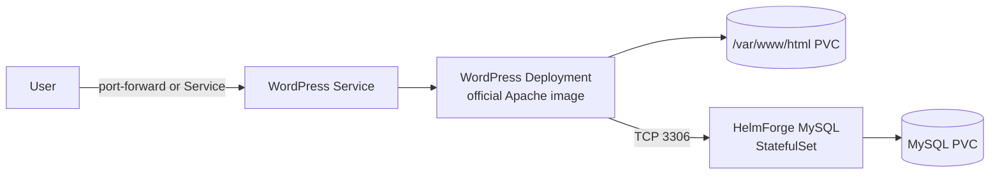
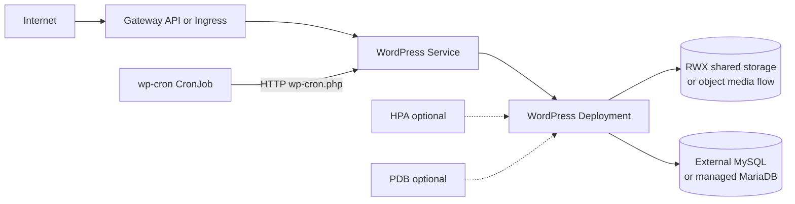
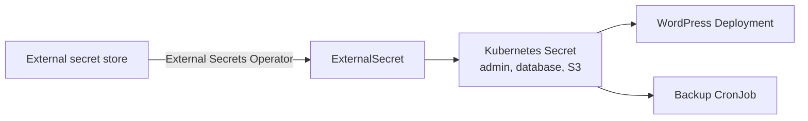
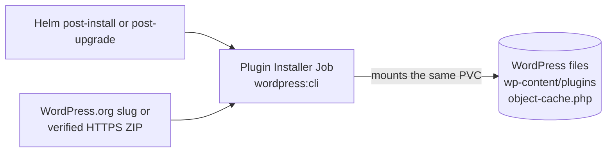
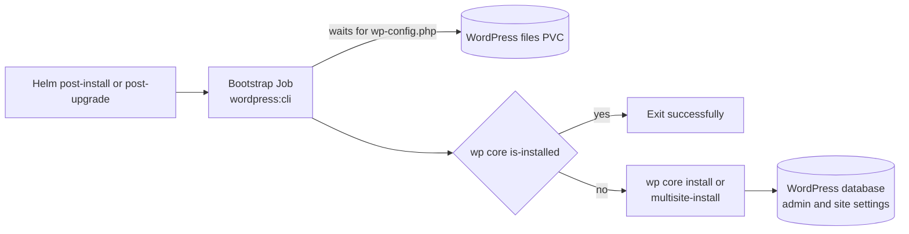
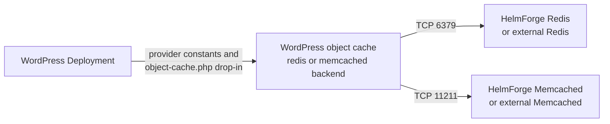
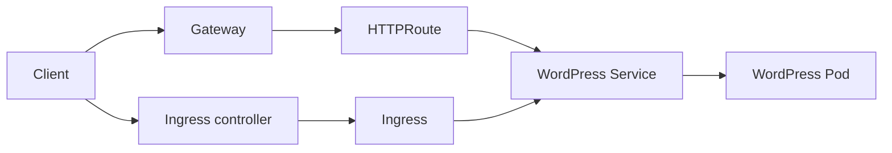
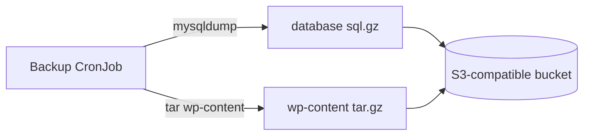

# WordPress Chart Design

This chart packages WordPress for Kubernetes using the official Apache image and HelmForge platform conventions.
The default install optimizes for a fast working environment, while production controls are opt-in and explicit.

## Scope

The chart owns a WordPress Apache workload, its Service and routing resources, persistent application files, database
wiring, optional bootstrap and plugin Jobs, scheduled cron and backup Jobs, metrics, network policy, and cache
integration. It supports the bundled HelmForge MySQL dependency or an external MySQL-compatible database.

## Goals

- Keep development installs simple.
- Provide a production path without forcing production defaults.
- Avoid raw overrides for common operational needs.
- Support both modern Kubernetes Gateway API and classic Ingress.
- Support native Kubernetes Secrets and External Secrets Operator.
- Make database, storage, cron, backup, and network choices visible.

## Design Decisions

- The upstream official Apache image remains the default. For non-default ports, an init container copies and adjusts
  its Apache configuration into a shared volume so the application container retains its image entrypoint and can run
  as a non-root user. Custom repositories opt in only when they retain the official `/etc/apache2` layout.
- `service.port` is independent from the application listener and targets the named `http` container port.
- Mutable content uses a shared PVC; immutable images and external media storage are preferred for replicated production.
- Bootstrap and plugin actions are idempotent Helm hooks with explicit timeouts and ReadWriteOnce-aware scheduling.
- Credentials use Kubernetes Secrets or External Secrets Operator references rather than command arguments.
- Native PHP extensions are image-build concerns and are never compiled during Pod startup.

## Default Architecture

This mode is useful for development, previews, and small internal installs. Credentials can be generated or supplied through values.

## Production Architecture With External Database

For more than one WordPress replica, the content strategy must be explicit.
Use ReadWriteMany storage for shared files, or operate plugins/themes/media through a deployment and object-storage strategy.

## Secrets Architecture

External Secrets is optional. Native Secrets remain available for development and simple clusters.
The chart prevents using an existing Secret and an ExternalSecret for the same credential at the same time.

## Plugin Installer Architecture

The installer is idempotent. It checks whether each plugin exists before downloading or installing it and activates
plugins only after WordPress core has completed installation. Official WordPress.org slugs and verified custom ZIPs
share the same lifecycle but remain separate value contracts.

Custom ZIPs cross an external-content trust boundary. The chart therefore requires HTTPS and a SHA-256 checksum,
accepts authentication only through an existing Secret, keeps the token out of rendered values and process arguments,
and rejects unsafe archive paths before writing to the shared volume. Download, checksum, archive, and activation
failures are distinct. Before `wp core install`, archives are extracted without database-backed WP-CLI operations and
activation is deferred.

It runs as UID/GID 33 (`www-data`) by default to match the official WordPress image file ownership on the shared PVC.
When persistence uses `ReadWriteOnce`, the Job uses pod affinity to schedule on the same node as the WordPress pod.
The Job is intentionally fail-fast with a 60 second active deadline and one retry by default.

## PHP Extension Image Architecture

WordPress plugins are application code on the shared content volume. PHP extensions are native modules in the runtime
image and cannot be installed by the plugin Job. The official image supplies `mysqli`, while modules such as
`pdo_mysql` and `memcached` require a derivative image.

Extension images are built before deployment from the same pinned official WordPress runtime and CLI tags. CI scans
the image before publication and emits an SBOM and provenance. Runtime compilation is outside the chart lifecycle and
is intentionally unsupported because it adds toolchains, network dependency, mutable startup state, and nondeterminism.
HelmForge provides an example pipeline but does not publish application-specific extension images.

## Bootstrap Architecture

The official WordPress image prepares files and `wp-config.php`, but it does not create the initial site.
The bootstrap Job provides that missing operational layer with WP-CLI. It is idempotent by default and exits
successfully when `wp core is-installed` is already true.

Bootstrap requires persistence because the Job and Deployment must share the initialized WordPress files.
It also requires an explicit site URL so production installs do not accidentally store an internal Kubernetes
Service URL in WordPress options.

## Object Cache Architecture

Redis integration is considered functional only when the drop-in exists and Redis receives cache keys after WordPress requests. A running Redis pod alone is not enough.
Redis is the plug-and-play provider for the official WordPress image because the selected plugin can use Predis.
Memcached is intentionally guarded: the official image does not include the required PHP extension, so the chart
requires a custom image or an explicit acknowledgement before rendering that provider.

## Routing Architecture

Gateway API is preferred for clusters that already standardize on Gateway resources. Ingress remains supported for broad compatibility.

## Security Boundary

- ServiceAccount token automount is disabled by default.
- The pod uses the `RuntimeDefault` seccomp profile and the WordPress container
  blocks privilege escalation. The official image starts Apache as root and
  switches workers to `www-data`, so capabilities are not dropped by default.
- NetworkPolicy is optional and starts with ingress isolation when enabled.
- Egress can be explicitly allowed for DNS, database, HTTPS, SMTP, and custom destinations.
- WordPress file editing can be disabled with `wordpress.disallowFileEdit`.
- Admin SSL can be enforced with `wordpress.forceSSLAdmin`.
- Secrets can be sourced from External Secrets Operator using `external-secrets.io/v1`.
- Custom plugin artifacts require HTTPS, a SHA-256 digest, and existing-Secret authentication.

The chart secures Kubernetes resources and the delivery contract, but it does not audit third-party plugin source code,
operate the external secret store, or replace image vulnerability management.

## Observability Boundary

The chart can expose Apache metrics and a ServiceMonitor, and Kubernetes surfaces container logs, events, Job status,
and probe results. It does not deploy Prometheus, alert rules, log storage, synthetic monitoring, or WordPress-specific
application performance monitoring. Operators own dashboards, alert thresholds, retention, and incident response.

## Availability Model

The chart exposes HPA and PDB, but it does not assume WordPress is safely horizontally scalable by default. Autoscaling is valid only when content writes are safe across replicas.

Use this order for production decisions:

1. Choose database mode and backup ownership.
2. Choose bootstrap mode and the initial site URL.
3. Choose content storage/media strategy.
4. Enable TLS routing.
5. Enable explicit resources, NetworkPolicy, metrics, and backups.
6. Add HPA/PDB only after storage and plugin behavior are safe for multiple pods.

## Production Boundary

Production operation requires explicit ownership of TLS, durable database service, shared or externalized content,
credential rotation, backup retention and restore testing, image scanning, monitoring, and upgrade validation. HPA and
PDB settings do not make a ReadWriteOnce WordPress installation highly available. The chart supplies controls for these
decisions but does not operate external databases, object stores, ingress controllers, or disaster recovery systems.

## Backup Model

The backup CronJob is designed as a practical baseline, not a full disaster recovery program.
Production users should test restores, retention, object lock, and database consistency in their own environment.

## Dependency Policy

The chart depends on HelmForge MySQL through `Chart.yaml`.
The repository workflow does not commit `Chart.lock` for this chart, so dependency resolution is performed during validation and packaging.

## Known Gaps

- The default PVC and single replica do not provide multi-node content availability.
- WordPress core and plugin health are not equivalent to end-user transaction monitoring.
- Custom plugin authentication supports bearer tokens, not arbitrary interactive or multi-step authentication flows.
- The chart does not validate the compatibility or trustworthiness of PHP code inside a checksum-verified ZIP.

## Non-Goals

- Operating a managed database, object-storage media service, ingress controller, or monitoring stack.
- Building or publishing user-specific WordPress images or native PHP extensions.
- Compiling operating-system packages or PHP extensions during Pod startup.
- Automatically approving plugin, theme, or WordPress core upgrades for production sites.
